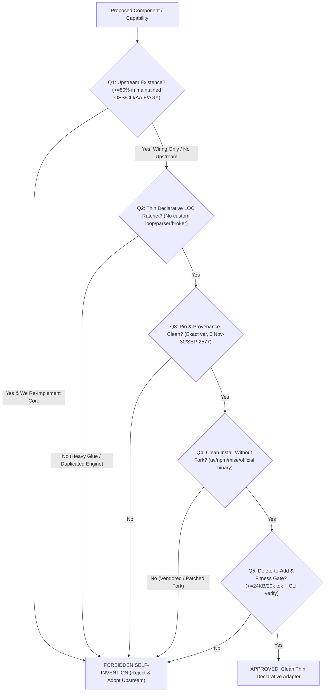

# ADR Practice, Architectural Knowledge Management & Research Convergence Saturation

**As-of Date:** 2026-11-26

This guide defines the Architectural Knowledge Management (AKM) doctrine, bounded **MADR 4.0.0** lifecycle, **7-Criterion Saturation Exit Gate**, **5-Artifact Truth-Division Matrix**, and **5-Question Zero-Self-Invention Falsification Gate** enforced by this repository.

---

## 1. SOTA ADR Practice & Agent-Native AKM

### 1.1 Lineage & Canonical Standards

| Standard / Practice | Origin & Verified Status (`2026-11-26`) | Role in This Repository |
| :--- | :--- | :--- |
| **Nygard ADRs** | Michael Nygard ([Cognitect, Nov 15, 2011](https://cognitect.com/blog/2011/11/15/documenting-architecture-decisions)) | Git-colocated, immutable-intent records capturing *"why"* a boundary was chosen. |
| **MADR 4.0.0** | ADR GitHub Org; **v4.0.0 released Sep 17, 2024** ([release](https://github.com/adr/madr/releases/tag/4.0.0), [site](https://adr.github.io/madr/)) | Canonical template with YAML frontmatter (`status`, `date`, `decision-makers`, `consulted`, `informed`), explicit `Considered Options` + `Pros and Cons`, and executable **`### Confirmation`** fitness checks. |
| **Thoughtworks Technology Radar & Lightweight ADRs** | Thoughtworks ([Lightweight ADRs](https://www.thoughtworks.com/radar/techniques/lightweight-architecture-decision-records)) | Ring taxonomy (*Adopt / Trial / Assess / Hold*) separating adopted upstreams from sunset/maintenance-mode technologies. |
| **Evolutionary Architecture & Fitness Functions** | Neal Ford, Rebecca Parsons, Pat Kua, Pramod Sadalage ([evolutionaryarchitecture.com](https://evolutionaryarchitecture.com/), [FFDD](https://www.thoughtworks.com/insights/articles/fitness-function-driven-development)) | Turns every ADR's `### Confirmation` section into executable atomic/holistic CI gates verified continuously. |
| **arc42 + C4 Model** | Gernot Starke ([arc42.org](https://arc42.org/)) & Simon Brown ([c4model.com](https://c4model.com/)) | C4 diagrams map structural layers; arc42 Section 9 links directly into `docs/adrs/`. |

### 1.2 Static Portal & AI-Agent-Native ADR Governance

| Tool / Control | Pinned Upstream (`2026-11-26`) | Governance Function |
| :--- | :--- | :--- |
| **Zensical Docs Portal** | `zensical==0.1.3` ([zensical.org](https://zensical.org/), [GitHub](https://github.com/zensical/zensical)) | Rust-core successor to Material for MkDocs; publishes `docs/` and `docs/adrs/` via `zensical.toml`. |
| **AST & ADR MCP Server** | `codebase-memory-mcp==0.12.1` ([GitHub](https://github.com/DeusData/codebase-memory-mcp)) | Exposes tree-sitter call graphs plus `manage_adr` CRUD so coding agents read architectural constraints before editing. |
| **Hybrid Local Search MCP** | `xerj` `v1.0.0-rc.105` ([GitHub](https://github.com/xerj-org/xerj)) | Single-binary Rust BM25 + kNN index over ADRs, specs, and corpus docs (`xerj autoindex`). |
| **Bounded ADR Set (`N = 12`)** | `docs/adrs/ADR-0001..ADR-0012.md` | Strict bijection: `ADR-0001` (`META`) + `ADR-0002`..`ADR-0012` <-> `L0`..`L10`, eliminating ADR sprawl and conflicting retrieval noise. |
| **Cryptographic Sealing** | `scripts/verify_manifest.py` (`15` gates) | Seals canonical manifest SHA-256 and `12/12` ADR file SHA-256 digests byte-for-byte into `manifest/compounding_manifest.v2.json`. |

### 1.3 Bounded ADR Lifecycle & 5-Artifact Truth-Division Matrix

**Lifecycle Transitions:** `proposed -> accepted -> updated in-place (re-sealed) | deprecated | superseded by ADR-XXXX`. Active canonical core records stay strictly bounded at `N = 12`, with superseded rationales preserved in Git history and release tags.

| Artifact | Authoritative Truth Owned | Loading Mechanism | Hard Budget / Gate |
| :--- | :--- | :--- | :--- |
| **`AGENTS.md`** | Non-discoverable universal repo invariants, security perimeter, verify commands. | Always-on session start across all harnesses. | **`<= 45` lines & `<= 1,600` chars** (`scripts/verify_manifest.py` Gate `[15]`). |
| **`.agents/rules/*.md`** | Path-scoped (`trigger: glob`) or conditional (`trigger: model_decision`) guardrails. | Conditional/hierarchical load. | **`<= 24,000 B`/file**; **`<= 20,000`** est. aggregate tokens. |
| **`.agents/skills/*/SKILL.md`** | Multi-step procedures, runbooks, scripts & eval fixtures. | Progressive disclosure (`name` + `description <= 1,024` chars). | Gated by `SkillEvaluator` Tiers 1–3 (`skill_lift >= +0.05`). |
| **`docs/adrs/ADR-0001..0012.md`** | Settled architectural *"why"*, rejected options, executable `### Confirmation`, pinned installs. | Zensical portal, `codebase-memory-mcp` (`manage_adr`), `XERJ`. | Exact `12` ADRs; 7-key frontmatter + 9 MADR 4.0 headings; SHA-256 sealed. |
| **`manifest/compounding_manifest.v2.json`** | Machine-readable pins, disjoint `L0`–`L10` map, routing, flywheel ratchets, sunsets & seals. | Programmatic CI verification (`scripts/verify_manifest.py --verify`). | Strict Draft 2020-12 schema; `15/15` gates + `12/12` ADR hash parity. |

---

## 2. Research Convergence & 7-Criterion Saturation Exit Gate

Bridging **Kitchenham EBSE / PRISMA** systematic reviews ([prisma-statement.org](https://www.prisma-statement.org/)), **Grounded Theory theoretical saturation**, **Thoughtworks Radar**, **RFC / Design Doc / ADR** separation, and **DACI / RAPID** ownership (mapped onto MADR 4.0 `decision-makers` / `consulted` / `informed`), convergence reaches **`saturation_status: "saturated"`** ONLY when all seven objective criteria pass:

| # | Saturation Criterion | Quantitative Exit Threshold | Verification Gate |
| :--- | :--- | :--- | :--- |
| **C1** | **Live Primary-Source Triangulation** | `100%` of claims verified against live primary specs, arXiv abstracts, or PyPI/npm/GitHub registries (zero opaque redirect URLs). | HTTP `200` link audit + live registry queries (`docs/clean-install-registry.md`). |
| **C2** | **Zero Unresolved Contradictions** | `unresolved_contradictions == 0` across docs, ADRs, install registry, and manifest. | Cross-track verification audit & Gate `[14]`. |
| **C3** | **Zero Unverified Claims / Placeholders** | `unverified_claims == 0`; zero `TBD`, `TODO`, or unpinned version strings in active artifacts. | Gate `[05]` & Gate `[13]` in `scripts/verify_manifest.py`. |
| **C4** | **Strictly Disjoint Layer Bijection** | `11` layers (`L0`–`L10`), `0` overlaps, `0` gaps, mapped 1:1 to `12` bounded ADRs (`META` + `L0`–`L10`). | Gate `[06]` & Gate `[11]` in `scripts/verify_manifest.py`. |
| **C5** | **Exhaustive Option Elimination** | Every ADR evaluates `>= 3` concrete options with falsification evidence for rejected alternatives. | MADR 4.0 `Considered Options` & `Pros and Cons` audit across `12/12` ADRs. |
| **C6** | **Independent Adversarial Verification** | Double `--verify` (`exit 0`) PLUS isolated temp-dir negative-guard mutations (`12/12` exit `1`). | `python3 -m unittest discover -s tests -v`. |
| **C7** | **Cryptographic Reproducibility** | Canonical UTF-8 sorted-key JSON SHA-256 + `12/12` ADR file SHA-256 parity verified byte-for-byte. | Gate `[01]`, `[12]`, `[14]` in `scripts/verify_manifest.py`. |

---

## 3. The 5-Question Zero-Self-Invention Falsification Gate

Every proposed tool, hook, script, or memory/orchestration adapter MUST clear all five questions before merging:

1. **Q1 — Upstream Existence Test:** If a maintained upstream engine, AGY native primitive, or AAIF/CNCF standard already solves `>= 80%`, adopt it directly—never duplicate its core loop, parser, or transport.
2. **Q2 — Thin Declarative LOC Ratchet:** Limit custom code strictly to declarative configs (`hooks.json`, `sidecar.json`, `mcp_config.json`, `SKILL.md`) or single-purpose `< 150` LOC fail-closed bridges.
3. **Q3 — Pin & Provenance Test:** Pin exact immutable versions (`==X.Y.Z` / `@X.Y.Z` / release tag) with verified official URLs; ban retiring `2026-11-30` models, MCP `SEP-2577` Roots/Sampling/Logging, and maintenance-mode AutoGen/Semantic Kernel.
4. **Q4 — Clean-Install-Without-Fork Test:** Provision cleanly via `uv`, `mise`, `npm --save-exact`, or verified release binary—zero vendored copies, zero patched `site-packages`, zero global `pip install`.
5. **Q5 — Delete-to-Add & Fitness Proof:** Preserve `AGENTS.md` (`<= 45` L / `1,600` c), rule (`<= 24 KB` / `20k` tokens), and eager-MCP (`<= 3`) budgets, and ship an executable `### Confirmation` command returning `exit 0`.

---

## 4. Authoritative References

* [MADR 4.0.0 Specification](https://adr.github.io/madr/) | [Release 4.0.0](https://github.com/adr/madr/releases/tag/4.0.0) | [Michael Nygard (2011)](https://cognitect.com/blog/2011/11/15/documenting-architecture-decisions)
* [Thoughtworks Lightweight ADRs](https://www.thoughtworks.com/radar/techniques/lightweight-architecture-decision-records) | [Fitness Function-Driven Development](https://www.thoughtworks.com/insights/articles/fitness-function-driven-development) | [Evolutionary Architecture](https://evolutionaryarchitecture.com/)
* [arc42](https://arc42.org/) | [C4 Model](https://c4model.com/) | [PRISMA](https://www.prisma-statement.org/) | [Zensical (`0.1.3`)](https://zensical.org/) | [codebase-memory-mcp (`0.12.1`)](https://github.com/DeusData/codebase-memory-mcp) | [XERJ (`v1.0.0-rc.105`)](https://github.com/xerj-org/xerj)
* [ETH Zurich Evaluating AGENTS.md (`arXiv:2602.11988`)](https://arxiv.org/abs/2602.11988) | [SkillsBench (`arXiv:2602.12670`)](https://arxiv.org/abs/2602.12670)
