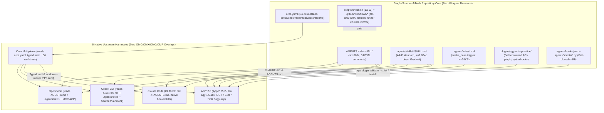

# AGY Harness Frameworks, Meta-Harness Audit & Full-Landscape SOTA Practice

**As-of Date:** 2026-11-26  
**Manifest Baseline:** `v3.2.0` (`ADR-0001`, `ADR-0004`, `ADR-0005`, `ADR-0010`, `ADR-0012`)

This guide answers the decisive architectural question for late-2026 **Google Antigravity (`AGY 2.0`)** teams: **should you install a third-party meta-harness wrapper daemon (`OMC`, `OMX`, `OmO`, `OmA`, `Ruflo`, `BMAD`) on top of AGY, or build directly on native AGY primitives plus a thin, `agy plugin validate`-verified plugin pack?**

---

## 1. Empirical Thesis: Native-First Runtime + Thin Plugin Pack > Wrapper Daemons

Empirical benchmarks, security advisories, and live ecosystem audits across `2026` converge on an unambiguous rule: **never layer a stateful meta-harness wrapper daemon on top of AGY 2.0.** Adopt the winning engineering *patterns* natively, and distribute only thin, zero-daemon declarative guardrails, Grade-A skills, least-privilege subagents, and opt-in fail-closed hooks via a validated native plugin (`plugins/agy-sota-practice/`).

Four primary empirical sources anchor this doctrine:

1. **Harness Design Drives Performance — Not Persona Bloat (Stanford *Meta-Harness*, Mar 2026 — [`arXiv:2603.28052`](https://arxiv.org/abs/2603.28052)):** Automated harness optimization over raw execution traces produced `+7pp` to `+15pp` gains on Terminal-Bench 2.0 on frozen model weights by improving tool interfaces, context selection, and error feedback — *not* by injecting dozens of eager role personas.
2. **Curated Lean Skills Beat Bulk Skill Dumps (*SkillsBench*, Feb 2026 — [`arXiv:2602.12670`](https://arxiv.org/abs/2602.12670)):** Controlled ablations across 84+ tasks prove that tightly scoped, evaluated skills deliver measurable Skill Lift, whereas uncurated or self-generated skill dumps degrade reliability and inflate variance.
3. **Bloated Context Files Hurt Cost Without Lifting Accuracy (ETH Zurich *Evaluating AGENTS.md*, Feb 2026 — [`arXiv:2602.11988`](https://arxiv.org/abs/2602.11988)):** Over-specified repository context files failed to lift SWE-bench pass rates while raising inference costs by `>20%` via redundant exploration — directly motivating our `AGENTS.md <= 45L / <= 1,600c` (`0` HTML comments) + progressive-disclosure `.agents/rules/*.md` ratchet.
4. **Wrapper Daemons & Unauthenticated Bridges Create Catastrophic Risk (Ruflo *"RufRoot"* — [`CVE-2026-59726`](https://nvd.nist.gov/vuln/detail/CVE-2026-59726) / [`GHSA-c4hm-4h84-2cf3`](https://github.com/advisories/GHSA-c4hm-4h84-2cf3), CVSS `10.0`):** `ruvnet/ruflo < v3.16.3` shipped a default Docker Compose MCP bridge (`POST /mcp`) bound to `0.0.0.0:3001` with zero authentication and no tool deny-list, enabling unauthenticated Remote Code Execution (`ruflo__terminal_execute`), container `process.env` API-key exfiltration, and persistent `AgentDB` memory poisoning. This repository blocks that entire vulnerability class structurally via `rules/ast-grep/no-wildcard-mcp-bridge-bind.yml`.

---

## 2. Live-Verified (`2026-11-26`) 19-Project Meta-Harness & AGY Kit Census

Every star count, license, release tag, and URL below was verified live on `2026-11-26` (all URLs HTTP `200`).

### 2.1 Group A — CLI Wrapper Daemons & Multi-Model Meta-Harnesses

| Project | Repository | Stars | License | Verified Release (`Date`) | Observed Footprint | Failure Modes & Risk | AGY 2.0 Verdict |
| :--- | :--- | ---: | :--- | :--- | :--- | :--- | :--- |
| **`oh-my-claudecode` (`OMC`)** | [`Yeachan-Heo/oh-my-claudecode`](https://github.com/Yeachan-Heo/oh-my-claudecode) | `41,084` | `MIT` | `v5.8.9` (`2026-11-25`) | `19` agents, `85` skills, `2` hook suites, Node/TS `.omc` state | Prompt/skill bloat (`85` skills), full-privilege shell hooks, redundant with AGY `/goal`, `/swarm`, `/teamwork` | **Quarantine Wrapper / Adopt Patterns Natively** |
| **`oh-my-codex` (`OMX`)** | [`Yeachan-Heo/oh-my-codex`](https://github.com/Yeachan-Heo/oh-my-codex) | `33,852` | `MIT` | `v0.22.29` (`2026-11-26`) | `29` skills, Rust + Node wrapper, HUDs | Wrapper drift across fast-moving `openai/codex` (`rust-v0.172.0`); duplicates AGY `/plan`, `/swarm`, `/statusline` | **Quarantine Wrapper / Adopt Patterns Natively** |
| **`oh-my-openagent` (`OmO`, fka `oh-my-opencode`)** | [`code-yeongyu/oh-my-openagent`](https://github.com/code-yeongyu/oh-my-openagent) | `71,146` | **SUL-1.0** *(non-OSI)* | `v5.1.84` (`2026-11-26`) | Rust + Node multi-model graph wrapper | **Non-OSI Sustainable Use License 1.0**; multi-model MCP prompt-injection surface; superseded by AGY `Orchestrator` + `/boost` + `codebase-memory-mcp` | **Quarantine / Ban Wrapper** |
| **`oh-my-pi` (`OMP`)** | [`can1357/oh-my-pi`](https://github.com/can1357/oh-my-pi) | `39,976` | `MIT` | `v19.2.1` (`2026-11-25`) | Standalone Rust + TS agent built on [`earendil-works/pi`](https://github.com/earendil-works/pi) | Full standalone harness (not an AGY plugin); running beside AGY splits session history, sandboxing, and auth | **Peer Standalone Harness (Do Not Wrap; Cherry-Pick Structural Patching Patterns)** |
| **`Ruflo` (fka `claude-flow`)** | [`ruvnet/ruflo`](https://github.com/ruvnet/ruflo) | `82,511` | `MIT` | `v3.80.9` (`2026-11-26`) | Rust + Node swarm/MCP/Docker meta-harness | **CVSS `10.0` `CVE-2026-59726` / `GHSA-c4hm-4h84-2cf3`** (`< v3.16.3` unauthenticated `0.0.0.0:3001` RCE + key theft + `AgentDB` poisoning); massive daemon surface | **Quarantine / Ban Wrapper** |

### 2.2 Group B — Methodology, Skill-Pack & Specification Frameworks

| Project | Repository | Stars | License | Verified Release (`Date`) | Observed Footprint | Trade-Offs & Failure Modes | AGY 2.0 Verdict |
| :--- | :--- | ---: | :--- | :--- | :--- | :--- | :--- |
| **`Superpowers`** | [`obra/superpowers`](https://github.com/obra/superpowers) | `327,538` | `MIT` | `v7.0.2` (`2026-11-03`) | `15` skills, `4` hooks, `.agents/` + `.claude-plugin/` | Strong TDD/worktree/verification habits, but full `hooks/` wrapper collides with AGY `/plan`, `/swarm`, and host `PreToolUse` | **Adopt Patterns Natively / Cherry-Pick Audited Skills Only** |
| **`Compound Engineering Plugin`** | [`EveryInc/compound-engineering-plugin`](https://github.com/EveryInc/compound-engineering-plugin) | `26,249` | `MIT` | `v3.38.3` (`2026-11-23`) | `39` skills, `plugin.json` + `.claude-plugin/` | Pioneered `brainstorm -> plan -> work -> review -> compound` flywheel; bulk-loading `39` skills bloats routing & `docs/solutions/` rots without compaction | **Adopt Flywheel Natively (`/plan`, `/swarm`, `/learn`, ADRs) / Cherry-Pick <=3 Skills** |
| **`gstack`** | [`garrytan/gstack`](https://github.com/garrytan/gstack) | `142,746` | `MIT` | `v1.104.0.0` (`2026-11-26`) | `23` opinionated startup-role workflows + browser QA | Proven role-separated perspective switching & browser QA; `23` overlapping prompts duplicate AGY `/grill-me`, `agents/*.md`, and built-in isolated browser | **Adopt Verifier + Browser QA Patterns / Quarantine 23-Command Pack** |
| **`GitHub Spec Kit`** | [`github/spec-kit`](https://github.com/github/spec-kit) | `151,687` | `MIT` | `v1.4.5` (`2026-11-25`) | Python CLI enforcing 6-stage SDD pipeline | Strong greenfield alignment; `5x`–`9x` process overhead & spec-to-code markdown drift on brownfield fixes | **Cherry-Pick Greenfield Only / Quarantine on Brownfield** |
| **`BMAD-METHOD`** | [`bmad-code-org/BMAD-METHOD`](https://github.com/bmad-code-org/BMAD-METHOD) | `55,800` | `MIT` | `v6.12.4` (`2026-10-14`) | Multi-persona agile methodology (`skills/`) | Heavy ceremony and sprawling story artifacts causing context pollution ("lost in the middle") | **Quarantine Wrapper** *(use bounded 1..12 MADR 4.0.0 ADRs + `/swarm`)* |

### 2.3 Group C — External Memory & Cross-Terminal Utilities

| Project | Repository | Stars | License | Verified Release (`Date`) | Observed Footprint | Trade-Offs & Failure Modes | AGY 2.0 Verdict |
| :--- | :--- | ---: | :--- | :--- | :--- | :--- | :--- |
| **`Beads` (`bd`, fka `steveyegge/beads`)** | [`gastownhall/beads`](https://github.com/gastownhall/beads) | `29,131` | `MIT` | `v1.3.4` (`2026-11-04`) | Go + Dolt distributed graph issue tracker | Adds heavy Dolt database daemon duplicating GitHub Issues, AGY `update_steps` + `/swarm`, and disjoint `L7` (`codebase-memory-mcp`, `Graphiti`, `Letta`) | **Retire / Do Not Bundle** |
| **`hcom`** | [`aannoo/hcom`](https://github.com/aannoo/hcom) | `678` | `MIT` | `v0.7.31` (`2026-10-21`) | Rust cross-terminal PTY/CLI relay | Terminal/PTY fragility across CLI updates; cleanly superseded by `ConversationService`, `agy acp`, `Orca` typed mail, and AAIF `A2A v1.0` | **Quarantine / Retire Wrapper** |

### 2.4 Group D — Late-2026 AGY Official Marketplaces & Community Kits

| Project / Channel | Live URL | Stars | License | Verified Release (`Date`) | Evaluation & AGY 2.0 Verdict |
| :--- | :--- | ---: | :--- | :--- | :--- |
| **Official AGY Marketplaces** (`antigravity-plugins-official`, `antigravity-plugins-partners`) | [`plugins.md`](https://antigravity.google/docs/plugins.md) & [`marketplace.md`](https://antigravity.google/docs/marketplace.md) | Official | Proprietary / Partner | Live (`App 2.35.2` / `CLI 1.5.18`) | **ADOPT NATIVELY (Primary Distribution Channel)** — signed/curated, atomic enable/disable, native `agy plugin validate` compliance |
| **`Conductor` (`gemini-cli-extensions`)** | [`gemini-cli-extensions/conductor`](https://github.com/gemini-cli-extensions/conductor) | `3,808` | `Apache-2.0` | Active (`2026-09-01`) | **ADOPT ARCHITECTURE PATTERN** — gold-standard thin dual-harness (`plugin.json` + `.claude-plugin/`, `1` rule, `6` skills) reference |
| **`Agentic Awesome Skills` (fka `antigravity-awesome-skills`)** | [`sickn33/agentic-awesome-skills`](https://github.com/sickn33/agentic-awesome-skills) | `50,397` | `MIT` | `v21.4.0` (`2026-11-26`) | **QUARANTINE BULK INSTALL / CHERRY-PICK ONLY** — `3,151` skills; never bulk-install; cherry-pick single skills gated by `skillevaluator==1.2.1` + SHA lock |
| **`oh-my-antigravity` (`OmA` — Joonghyun-Lee-Frieren)** | [`Joonghyun-Lee-Frieren/oh-my-antigravity`](https://github.com/Joonghyun-Lee-Frieren/oh-my-antigravity) | `229` | `MIT` | `v1.2.0` (`2026-11-17`) | **QUARANTINE WRAPPER** — reproduces `OMC` bloat (`16` agents + `64` skills) on top of native AGY 2.0 primitives |
| **`oh-my-antigravity` (`HengWeiBin`)** | [`HengWeiBin/oh-my-antigravity`](https://github.com/HengWeiBin/oh-my-antigravity) | `10` | `MIT` | `v0.6.0` (`2026-11-23`) | **QUARANTINE WRAPPER** — early `OmO` port (`11` agents + `47` skills) duplicating native AGY orchestration |
| **`agy-fast`** | [`INK-Q/agy-fast`](https://github.com/INK-Q/agy-fast) | `1,730` | `MIT` | Active (`2026-11-27`) | **DO NOT LAYER (Redundant with `L7`)** — disjoint `codebase-memory-mcp 0.12.1` + `xerj v1.0.0-rc.105` already eliminates redundant file-read turns cleanly |
| **`wshobson/agents` & `awesome-antigravity-plugins`** | [`wshobson/agents`](https://github.com/wshobson/agents) (`42,935★`) / [`awesome-antigravity-plugins`](https://github.com/biTQ-m/awesome-antigravity-plugins) (`80★`) | `42.9k` / `80` | `MIT` / Index | Active (`2026-11-24` / `26`) | **DISCOVERY / CHERRY-PICK ONLY** — audit any individual plugin against `agy plugin validate --strict` + `skillevaluator` + `gitleaks`; pair authoring style with [`anthropics/skills`](https://github.com/anthropics/skills) (`201k★`) and [`vercel-labs/agent-skills`](https://github.com/vercel-labs/agent-skills) (`35k★`) |

---

## 3. Exhaustive 14-Row Meta-Harness → Native AGY 2.0 Primitive Mapping

Every capability popularized by `OMC`, `OMX`, `Superpowers`, `Compound Engineering`, `Beads`, and `hcom` maps directly onto a native AGY 2.0 primitive (verified live on `App 2.35.2` / `agy 1.5.18` / `SDK 0.1.24`), leaving only **six thin, zero-daemon declarative gaps** filled by `plugins/agy-sota-practice/`:

| # | Meta-Harness Capability | Native AGY 2.0 Primitive | Surface Coverage | Native vs. Thin Gap Verdict |
| :---: | :--- | :--- | :--- | :--- |
| **1** | **Persistent Autonomous Loop** (`OMC` `autopilot` / `ralph`) | `/goal` + `Stop` hook (`continuationActive` / `executionNum`) + App `v2.35.1` auto-resume + `/schedule` | App, CLI, SDK | **Native Wins** — zero external watchdog daemon; optional thin `Stop` verifier in `hooks.json`. |
| **2** | **Parallel Multi-Agent Team** (`OMC` `ultrawork`/`team`, `OMX` tmux) | Native `/swarm` (`add`/`tasks`/`share`/`branch`/`fork`, `post_message`, zero-token `swarm_wait`, `@verifier`, `@monitor`) & `/teamwork` | App, CLI | **Native Wins Decisively** — zero tmux fragility, zero polling token burn (`swarm_wait` costs 0 tokens). |
| **3** | **Deep Multi-Round Reasoning** (`OMC` heavy escalation) | `/boost` + `Orchestrator` (Gemini 4 Neon/Carbon planner + Hydrogen executor) + `--effort` (`low\|medium\|high\|xhigh`) + mid-turn switch | App, CLI, IDEs | **Native Wins Decisively** — native effort tiers and dual-model routing without proxy/OAuth ToS risk. |
| **4** | **Scripted Fan-Out / Staged DAG** | Dynamic Workflows (`/run-workflow` & SDK `beta.workflows`: `phase()`, `agent()`, `parallel()`, `pipeline()`, `call_tool()`, JSON Schema `finish`) | App, CLI, SDK | **Native Engine + Thin Gap** — ship reusable `workflows/*.py` + `workflow.json` audit pipelines. |
| **5** | **Structured Planning & Design Interview** (`ralplan`, `brainstorming`) | `/plan` (read-only exploration + reviewable artifact) + `/grill-me` + `ask_question` UI widget | All Surfaces | **Native Wins** — reviewable UI artifacts beat terminal prompt macros. |
| **6** | **Live HUD / Progress Tracker** (`OMC`/`OMX` tmux HUD) | CLI `/statusline` + `update_steps` / `update_focus` + App Overview panel & Sidecar pills | App, CLI | **Native Wins** — structured status widgets without scraping PTY streams. |
| **7** | **Specialized Role Subagents** (`OMC` 19–30 agents) | `agents/<name>.md` (`mainAgent`, `subagent`, `model`, least-privilege `tools`, `commandExecutionPolicy`) + `invoke_subagent` | All Surfaces | **Native Engine + Thin Gap** — avoid 30-agent bloat; ship **2** surgical read-only subagents (`sota-auditor`, `adr-steward`). |
| **8** | **Verification Before Completion** (`superpowers`, `ultraqa`) | `hooks.json` (`PreToolUse`/`Stop`) + pinned static gates (`ast-grep`, `ruff`, `ty`, `gitleaks`, `zizmor`, `shellcheck`, `syft`->`osv-scanner`, `verify_manifest.py`) | All Surfaces + CI | **Thin Declarative Gap (High Leverage)** — fail-closed exit-0 hooks, `ast-grep` bans, and unified `scripts/check.sh`. |
| **9** | **Persistent Memory & Task Graph** (`beads`, `OMC` notepad) | Tri-Layer Memory (`ADR-0009`): Procedural (`AGENTS.md` + rules + `/learn`), Episodic/Code (`codebase-memory-mcp` + `xerj` + SQLite + `/compact`), Semantic (`Graphiti`/`Letta`/`Mem0`) | All Surfaces + MCP | **Native + Pinned Upstreams Win** — AST call graphs & hybrid search replace fragile JSON notepads and Dolt daemons. |
| **10** | **Cross-Session Relay & Multi-Harness Mail** (`hcom`) | `ConversationService` (`v2.35.0+` lifecycle only) + Sidecars (`agentapi`) + typed SHA-256 `handoff_packet.json` + `agy acp` + `Orca` + `A2A v1.0` | App, CLI, Cross-Org | **Native + Thin Gap** — ship typed `handoff_packet.schema.json` + SHA-256-dedup `cross_session_hooks.py`. |
| **11** | **Reusable Skill Packs & Slash Commands** (`superpowers`, `gstack`) | Native AGY Plugin (`plugin.json` + `skills/<name>/SKILL.md` -> `/<name>`) gated by `agy plugin validate --strict` + `skillevaluator 1.2.1` | All Surfaces | **Native Engine + Thin Gap** — ship `1–3` orthogonal Grade-A (`>=95/100`) domain skills, never mega-packs. |
| **12** | **Compounding Retrospective Loop** (`/workflows:compound`) | Native `/learn` + `/compact` + `/btw` + 7-Stage Compounding Flywheel + `DSPy`/`GEPA` | App, CLI, Eval CI | **Native + Thin Gap** — enforce delete-to-add anti-bloat ratchet & prose -> `ast-grep`/hook escalation. |
| **13** | **Execution Isolation & Security Guardrails** | Native OS Sandboxing (Linux namespaces, macOS Seatbelt, Windows AppContainer) + `Deny > Ask > Allow` (`Auto` reviewer) + fail-closed `PreToolUse` + isolated browser | App, CLI, SDK | **Native + Thin Gap** — wrap `PreToolUse` fail-closed (`exit 0` + `deny`) for URI decoding, symlinks, CSRF tokens & live broker ports. |
| **14** | **Interactive Dashboards & Tool UIs** | Native Generative UI + MCP Apps (`SEP-1865`, `io.modelcontextprotocol/ui` + `com.google.antigravity/ui` `ui://` iframes) | App + CLI fallback | **Native Wins** — sandboxed iframes eliminate side-running web dashboards. |

---

## 4. Full-Landscape 6-Pillar SOTA Practice (10 Harnesses × `L0`–`L10`)

### 4.1 The 6 Pillars Mapped to Disjoint Layers `L0`–`L10`

| Pillar | Layers | Native AGY 2.0 Core | Portable Cross-Harness SOTA Stack (`2026-11-26`) | Wrapper Permanently Eliminated |
| :--- | :--- | :--- | :--- | :--- |
| **P1 — Isolated Execution & Frontier Routing** | `L0`, `L1`, `L2` | OS-native [Sandbox](https://antigravity.google/docs/sandbox.md), post-Nov-30 [Models](https://antigravity.google/docs/models.md) + `Orchestrator` + `/effort`, 5 AGY surfaces + `agy acp` | Cloud microVMs (`E2B 2.66.0`, `Daytona 2.3.0`, `Modal 1.6.4`, `Cloudflare Sandbox 1.0.3`); `LiteRT-LM 0.20.0`; 10 interoperable harnesses | `OMP` side-by-side install; `OmO` multi-model proxies |
| **P2 — Progressive Customizations & Thin Plugin** | `L2`, `L3` | `AGENTS.md` (`<=45L/1,600c`, `0` HTML comments), snake_case `.agents/rules/*.md`, `SKILL.md` (`<=1,024c`), `plugins/agy-sota-practice/` (`agy plugin validate --strict` `0` findings) | Dual-harness SSOT: `AGENTS.md` (+ `CLAUDE.md` symlink), AAIF `SKILL.md`, `1–3` Grade-A skills + `2` read-only subagents | `OMC` (`85` skills), `OmA` (`64` skills), `agentic-awesome-skills` bulk dumps |
| **P3 — Tiered Orchestration & Durability** | `L3`, `L4`, `L6` | `/swarm`, `/teamwork`, `/goal`, `/run-workflow`, `/plan`, `/grill-me`, `ConversationService`, Sidecars, `agy acp` | `Orca v1.4.278` (no `defaultTabs`), `A2A v1.0`, `DBOS 3.7.0`, `Temporal 1.37.0`, `Restate 1.5.5`, `Google ADK`, `PydanticAI`, `LangGraph`, `MAF` | `OMC`/`OMX`/`OmO`/`Ruflo` swarm daemons; `hcom`; `BMAD-METHOD` |
| **P4 — Protocol-Native Tools & Disjoint Memory** | `L5`, `L7` | `MCP 2026-07-28` (`0` `SEP-2577`), MCP Apps (`ui://`), `/learn`, `/compact` | `codebase-memory-mcp 0.12.1` + `xerj v1.0.0-rc.105` + `Graphiti 0.32.1` / `Letta 0.34.12` / `Mem0 2.2.1` | `Beads` Dolt daemon; `Ruflo` `0.0.0.0` MCP bridges; `agy-fast` |
| **P5 — Fail-Closed Policy & Supply-Chain CI** | `L8` | `Deny > Ask > Allow` (`0` `~/`), root `hooks.json` (`exit 0` + `deny`), isolated browser | `ast-grep 0.51.3` (incl. `no-wildcard-mcp-bridge-bind`), `ruff`, `ty`, `shellcheck`, `gitleaks 8.30.1`, `zizmor 1.33.1`, `trivy`, `syft`->`osv-scanner`, 40-char SHA + `harden-runner v2.23.0` | Unvetted third-party shell hooks; prose-only safety rules |
| **P6 — Adversarial Evals & Sealed Governance** | `L9`, `L10` | Native SDK OTel GenAI tracing, 18-gate sealed manifest, bounded 12 MADR 4.0.0 ADRs | `Inspect AI 0.3.292` + `Harbor 0.27.0` + `Promptfoo 0.126.0` + `skillevaluator 1.2.1` + `DSPy 3.5.0`/`GEPA 0.1.4` + `OTel 1.45.2` + `Zensical 0.1.3` | Unmeasured prompt packs; drifting `Spec Kit`/`BMAD` markdown |

### 4.2 Live-Verified 10-Harness Interoperability Matrix (`2026-11-26`)

| Coding Harness | Live Canonical Source | Verified Release (`2026-11-26`) | License | Charter / Rules | Skills / Plugins | Protocols |
| :--- | :--- | :--- | :--- | :--- | :--- | :--- |
| **Google Antigravity (`AGY 2.0`)** | [`google-antigravity/antigravity-cli`](https://github.com/google-antigravity/antigravity-cli) | `App 2.35.2` / `CLI 1.5.18` / `IDE 2.8.0` / `SDK 0.1.24` | Proprietary (`SDK`: Apache-2.0) | `AGENTS.md` + `.agents/rules/*.md` | `SKILL.md` + native `plugin.json` | `MCP 2026-07-28`, `agy acp`, `A2A` |
| **Anthropic Claude Code** | [`anthropics/claude-code`](https://github.com/anthropics/claude-code) | `v2.1.332` (`157,226★`) | Proprietary | `CLAUDE.md` (`@AGENTS.md`) + `.claude/rules/` | `SKILL.md` + `.claude-plugin/` | `MCP`, Agent SDK |
| **OpenAI Codex CLI** | [`openai/codex`](https://github.com/openai/codex) | `rust-v0.172.0` (`136,586★`) | `Apache-2.0` | `AGENTS.md` + `.codex/rules/` | `SKILL.md` + `.agents/skills` | `MCP`, Agents SDK |
| **OpenCode** | [`anomalyco/opencode`](https://github.com/anomalyco/opencode) | `v1.19.6` (`229,422★`) | `MIT` | `AGENTS.md` + `opencode.json` | `SKILL.md` + plugin hooks | `MCP`, `ACP` |
| **Gemini CLI** | [`google-gemini/gemini-cli`](https://github.com/google-gemini/gemini-cli) | `v0.71.1` (`109,198★`) | `Apache-2.0` | `AGENTS.md` / `GEMINI.md` | `SKILL.md` + extensions (`conductor`) | `MCP`, `ACP`, `A2A` |
| **AAIF Goose** | [`aaif-goose/goose`](https://github.com/aaif-goose/goose) | `v1.61.1` (`57,042★`) | `Apache-2.0` | `AGENTS.md` / recipes | `SKILL.md` + MCP extensions | `MCP`, `ACP`, `A2A` |
| **OpenHands** | [`OpenHands/OpenHands`](https://github.com/OpenHands/OpenHands) | `v1.46.0` (`94,423★`) | `MIT` | Repo instructions / microagents | `SKILL.md` + microagents | `MCP`, Cloud SDK |
| **Pi (`earendil-works/pi`)** | [`earendil-works/pi`](https://github.com/earendil-works/pi) | `v1.6.1` (`124,091★`) | `MIT` | `AGENTS.md` | Minimalist composable extensions | Unified LLM API |
| **Cursor** | [`cursor.com/docs`](https://cursor.com/docs) | Rolling (`2026`) | Proprietary | `AGENTS.md` + `.cursor/rules/` | `SKILL.md` + marketplace plugins | `MCP`, `ACP` |
| **Windsurf** | [`docs.windsurf.com`](https://docs.windsurf.com/) | Rolling (`2026`) | Proprietary | `AGENTS.md` + `.windsurf/rules/` | `SKILL.md` + workflows | `MCP` |

---

## 5. Five-Harness Single-Source-of-Truth (SSOT) Portability Topology

One clean repository serves **AGY 2.0, Claude Code, Codex CLI, OpenCode, and Orca** simultaneously with **zero wrapper daemons** and **zero hook collisions**:



---

## 6. Using the Zero-Wrapper AGY Practice Plugin Pack (`plugins/agy-sota-practice/`)

This repository ships a self-contained, `agy plugin validate --strict --json`-clean native AGY plugin pack (`plugins/agy-sota-practice/`) governed mechanically by `scripts/verify_manifest.py` **Gate `[18]`** (`agy_practice_plugin_and_zero_wrapper_contract`):

- **Zero Idle Token Tax:** Ships two progressive-disclosure rules (`rules/sota-harness-guardrails.md` [`model_decision`] and `rules/governance-files-guard.md` [`glob`]) and intentionally omits `rules/AGENTS.md` (`0` tokens on unrelated turns).
- **Three Orthogonal Grade-A Skills (`skillevaluator tier1 --no-llm >= 95/100`, `0` HIGH/CRIT):** `skills/sota-practice-audit/SKILL.md`, `skills/adr-madr4-review/SKILL.md`, and `skills/cross-session-handoff/SKILL.md`.
- **Two Least-Privilege Read-Only Subagents:** `agents/sota-auditor.md` (`commandExecutionPolicy: sandbox`, zero write tools) and `agents/adr-steward.md` (`commandExecutionPolicy: off`, `inheritMcp: false`, pure read-only).
- **Zero Global Hook Collision:** Root `hooks.json` ships both `sota-practice-fail-closed-opt-in` and `sota-practice-continuity-opt-in` with `"enabled": false` and relative `./scripts/*.py` (`0755`) commands.
- **Mathematically Guaranteed Zero Drift:** All `8` packaged scripts, workflow pipelines, schemas, and templates are synced via `make sync-plugin` and verified byte-for-byte via SHA-256 in Gate `[18]`.

```bash
# Validate the packaged plugin strictly with AGY CLI (must exit 0 with findings: [])
agy plugin validate --strict --json plugins/agy-sota-practice

# Install directly from the live public GitHub repository into any AGY 2.0 workstation
agy plugin install https://github.com/seathatflowsinourveins/agy-sota-convergence/tree/main/plugins/agy-sota-practice

# Sync canonical .agents/ and workflows/ into the plugin pack after any authorized edit
make sync-plugin && bash scripts/check.sh
```
