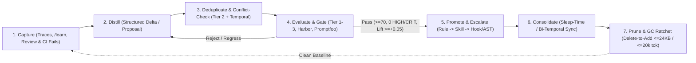

# Compounding Flywheel, Self-Improving Harnesses, Anti-Bloat Ratchets & KPIs

**As-of Date:** 2026-11-26

High-velocity AI coding without a gated compounding loop accelerates repository entropy rather than team output. This guide codifies the **7-Stage Compounding Flywheel**, **Probabilistic-to-Deterministic Escalation Ladder**, **Prompt-Cache / Effort Pareto Rules**, **Empirical Failure Counter-Measures**, and **Quantitative KPIs** synchronized 1:1 with `manifest/compounding_manifest.v2.json`.

---

## 1. Empirical Grounding (2025–2026 Industry & Research Synthesis)

* **Every Inc. Compound Engineering** ([guide](https://every.to/guides/compound-engineering), [plugin](https://github.com/everyinc/compound-engineering-plugin)): Inverts effort to **80% planning & review / 20% execution** via `Plan -> Work -> Review -> Compound`, writing verified lessons back into durable repo artifacts.
* **OpenAI Harness Engineering** ([Feb 11, 2026](https://openai.com/index/harness-engineering/)): Demonstrated ~1M LOC / ~1,500 PRs with zero manual lines; proved manual Friday "AI slop" cleanup fails to scale and replaced it with mechanical **Golden Principles** (linters/structural tests), **automated entropy GC PRs**, and **doc-gardening agents**.
* **Birgitta Böckeler's Guides & Sensors** ([Apr 2, 2026](https://martinfowler.com/articles/harness-engineering.html), [May 27, 2026](https://martinfowler.com/articles/sensors-for-coding-agents.html)): Partitions `Agent = Model + Harness` into **Guides (feedforward)** vs. **Sensors (feedback)** × **Computational (deterministic)** vs. **Inferential (semantic)**.
* **Anthropic Long-Running Harnesses** ([Nov 26, 2025](https://www.anthropic.com/research/effective-harnesses-for-long-running-agents)) & **AGY `/learn`** ([docs](https://antigravity.google/docs/commands/learn)): Pair atomic progress checkpoints and human-reviewed `learning_proposal.md` diffs that prefer updating existing rules/skills over creating duplicates.
* **Self-Improving Harness Research (Frozen Weights, Evolving Outer Loop):**
  * **SkillsBench** ([arXiv:2602.12670](https://arxiv.org/abs/2602.12670), Feb 13, 2026): Curated skills lift pass rates **+16.6 pp** (`33.9% -> 50.5%` across 87 tasks / 18 configs), while **unverified self-generated skills average −1.3 pp** (dropping up to −11.3 pp).
  * **ETH Zurich `AGENTS.md` Audit** ([arXiv:2602.11988](https://arxiv.org/abs/2602.11988), Feb 12, 2026): Boilerplate repo-overview context files fail to improve task success and inflate inference cost by **>20%**.
  * **ACE** ([arXiv:2510.04618](https://arxiv.org/abs/2510.04618), Oct 6, 2025): Prevents *brevity bias* and *context collapse* via **Generator -> Reflector -> Curator** itemized incremental deltas (`+10.6%` agent benchmarks, `+8.6%` finance).
  * **DSPy + GEPA** ([arXiv:2507.19457](https://arxiv.org/abs/2507.19457), Jul 25, 2025): Genetic-Pareto trace reflection outperforming GRPO RL at up to **35× fewer rollouts**.
  * **Letta Sleep-Time Compute + MemFS** ([arXiv:2504.13171](https://arxiv.org/abs/2504.13171); [Context Repos, Feb 12, 2026](https://www.letta.com/blog/context-repositories/)): Offline background consolidation into Git-backed Markdown+YAML memory trees.
  * **Evolutionary Harness Search:** **AlphaEvolve** ([arXiv:2506.13131](https://arxiv.org/abs/2506.13131)) / **OpenEvolve** ([GitHub](https://github.com/algorithmicsuperintelligence/openevolve)), **Darwin Gödel Machine** ([arXiv:2505.22954](https://arxiv.org/abs/2505.22954), SWE-bench `20.0% -> 50.0%`), **Hyperagents** ([arXiv:2603.19461](https://arxiv.org/abs/2603.19461)), **Meta-Harness** ([yoonholee.com/meta-harness](https://yoonholee.com/meta-harness/)), **Meta-Skills AI4AI** ([arXiv:2609.38143](https://arxiv.org/abs/2609.38143), `+8.95 pp`), and **Harnesses That Improve Themselves** ([arXiv:2611.22299](https://arxiv.org/abs/2611.22299), Nov 17, 2026).

---

## 2. The Canonical 7-Stage Compounding Flywheel

| Stage | Manifest Key | Mandatory Gate & Anti-Bloat Invariant |
| :--- | :--- | :--- |
| **1. Capture** | `capture` | Record failed-vs-fixed evidence with `t_valid`, commit SHA, and model/harness version; zero secrets logged. |
| **2. Distill** | `distill` | Classify into minimal non-discoverable invariant (`AGENTS.md`/Rule) vs. procedure (`SKILL.md`) vs. hard gate (`Hook`/AST); strip boilerplate repo maps. |
| **3. Deduplicate** | `deduplicate` | Run `skillevaluator similarity-check` (Tier 2 embeddings); patch existing artifacts over creating duplicates; bi-temporally invalidate (`t_invalid`) superseded facts. |
| **4. Evaluate & Gate** | `evaluate_gate` | Require `SkillEvaluator` Tier 1 `>= 70` & `0` HIGH/CRIT, Tier 3 all 5 dims `>= 0.50` & `skill_lift >= +0.05` (with `"expected_skill": null` negative case), `agy plugin validate --strict`, and `promptfoo` red-teaming. |
| **5. Promote & Escalate** | `promote_escalate` | **Escalation Ladder:** `Chat -> Minimal Rule -> Progressive Skill -> Fail-Closed PreToolUse Hook / AST Lint / CI Test` (delete superseded prose upon escalation!). |
| **6. Consolidate** | `consolidate_memory` | Reconcile episodic traces into bi-temporal KG (`graphiti-core`), Git-backed MemFS (`letta`), or MCP memory (`mem0ai`/`xerj`) offline via sleep-time/doc-gardening jobs. |
| **7. Prune & GC Ratchet** | `prune_gc_ratchet` | Enforce `AGENTS.md <= 45L / 1,600c`, `rule_file_max_bytes: 24000`, `rules_aggregate_budget_tokens: 20000`, `mcp_eager_max_tools: 3`, `delete_to_add_policy: true`, and `scripts/verify_manifest.py --verify`. |

---

## 3. Prompt-Cache, Effort Pareto & Failure-Mode Counter-Measures

* **Prefix Stability (`Gemini 4` & `Claude` & `MCP 2026-07-28`):** Keep static tool schemas (deterministic MCP `list_tools` ordering) and system instructions byte-identical at the top of prompts (`>= 4,096` tokens for Gemini 4 implicit caching; `Tools -> System -> Messages` for Claude `5m`/`1h` TTLs); inject dynamic turn context at the tail.
* **Effort Routing & Code Mode Threshold:** Use `low` (`Gemini 4 Hydrogen`) for high-fan-out/simple tasks, `medium` for daily engineering, `high`/`xhigh` (`Gemini 4 Neon` / `Carbon` / `Claude 5.5`) or **Orchestrator** for architecture/audits. Keep eager MCP tools `<= 3`; switch to **Code Mode / PTC** (`search` + `execute`, `<1,000` tokens) or AGY `run_workflow` whenever tool catalogs exceed `20–30` endpoints.
* **Five Naive-Compounding Traps Blocked Mechanically:**
  1. *Rule Bloat / Over-Obedience* (`arXiv:2602.11988`) -> `<= 45L / 1,600c` `AGENTS.md`, `<= 24 KB` rules, `delete-to-add`, Gate `[15]`.
  2. *Context Collapse* (`arXiv:2510.04618`) -> ACE itemized deltas + Git MemFS diffs (never monolithic LLM rewrites).
  3. *Skill Trigger Collisions* -> `skillevaluator similarity-check` + mandatory negative trigger case (`"expected_skill": null`).
  4. *Unverified Self-Edits* (`arXiv:2602.12670` `−1.3 pp`) -> Human review of `learning_proposal.md` + Tier 3 `skill_lift >= +0.05`.
  5. *Stale Facts & Reward Hacking* (`rdi.berkeley.edu`) -> Bi-temporal `t_invalid`, doc-gardening, and isolated fresh-sandbox **Inspect AI + Harbor** verifiers.

---

## 4. Compounding Quantitative KPIs & Alert Thresholds

| KPI | Target / Passing Bar | Alert / CI-Fail Trigger | Source |
| :--- | :--- | :--- | :--- |
| **First-Pass Verification Rate** | `>= 85%` of agent PRs pass all gates on turn 1 | `< 75%` triggers Stage-5 prose -> deterministic hook escalation | CI logs + OTel GenAI spans |
| **Skill A/B Lift (`Tier 3`)** | `skill_lift >= +0.05` & all 5 dims `>= 0.50` | `< +0.05` or any dim `< 0.50` blocks promotion | `skillevaluator tier3 evaluate` |
| **Rules Budget Utilization** | `< 50%` of `20k` tokens (`< 10k`) & `<= 24 KB`/file | `>= 80%` triggers GC sweep; `> 20k` fails Gate `[15]` | `scripts/verify_manifest.py` |
| **Delete-to-Add Ratio** | `>= 1.0` net prose removed/escalated per addition | `< 1.0` over 2 sprints triggers doc-gardening PR | Git diff stats on rules/`AGENTS.md` |
| **Fail-Closed Hook Escapes** | `0` false negatives across adversarial suite | Any escape (`> 0`) fails CI immediately | `tests/test_hooks_and_handoff.py` |
| **Sunset Lag** | `0` days past cutoff (`2026-11-30` / `2027-07-28`) | Any retiring slug in active slots fails Gate `[04]` | `scripts/verify_manifest.py` |
| **Manifest & 12-ADR Parity** | `100%` (`18/18` gates + `12/12` ADR SHA-256) | Any mismatch exits `1` fail-closed | `scripts/verify_manifest.py --verify` |
