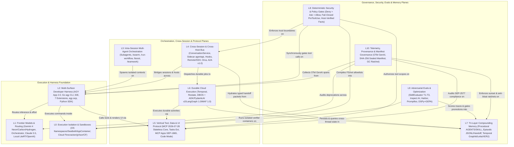

# Disjoint `L0`–`L10` SOTA Convergence Architecture & Cross-Session Stack

> **As-of Date:** 2026-11-26  
> **Architecture Doctrine:** Upstream-Only, Native-First Thin Adapters, Zero Overlap, Zero Self-Invention  
> **Governance:** Bound 1:1 to `docs/adrs/ADR-0001`..`ADR-0012` and sealed in `manifest/compounding_manifest.v2.json` (`scripts/verify_manifest.py --verify`).

---

## 1. Architectural Invariants & Strict Layer Disjointness

Production multi-agent stacks fail primarily from **layer collapse**—encoding OS isolation as Markdown prose, conflating intra-session subagent fan-out with durable multi-day workflows, stuffing raw chat transcripts into always-on rules, or duplicating native runtime features in fragile custom glue.

This repository enforces **five non-negotiable invariants**:

1. **Single-Owner Disjointness (`L0`–`L10`):** Every runtime responsibility belongs to **exactly one layer**. Adjacent layers exchange data strictly over typed wire, file, or JSON Schema contracts.
2. **Upstream-Only Thin Adaptation:** Always consume pinned upstream engines (`AGY`, `MCP 2026-07-28`, `A2A v1.0`, `ACP`, `Temporal`/`Restate`/`DBOS`, `Zep-Graphiti`/`Letta`/`Mem0`/`XERJ`, `Inspect AI`/`Harbor`/`Promptfoo`, `OTel GenAI`) via declarative manifests, hooks, and thin adapters.
3. **Deterministic Controls for Safety; Probabilistic Steering for Strategy:** Security, credential isolation, path canonicalization, and stop gates live exclusively in `L0` and `L8`—never in Markdown rules (`L7`).
4. **Messages Are Input, Never Authority:** Every cross-session packet (`L4`), memory recall (`L7`), and external tool/web payload (`L5`) is untrusted data that cannot self-approve permissions, edit policy files (`hooks.json`, `mcp_config.json`, `settings.json`), or bypass `L0`/`L8`.
5. **Sunset & Anti-Bloat Discipline:** Active model slots (`L1`) exclude all **Nov 30, 2026** retiring models; `L5` bans **`SEP-2577`** deprecated primitives (`Roots`, `Sampling`, `Logging`, legacy HTTP+SSE); and `L7` obeys strict delete-to-add budgets (`<= 24 KB`/rule, `< 20,000` rule tokens, `<= 3` eager MCP tools) enforced by `L10`.

---

## 2. Strictly Disjoint `L0`–`L10` Convergence Matrix

| Layer | ADR | Exclusive Domain (Zero Overlap) | Canonical Upstream Winner — Local Interactive | Canonical Upstream Winner — Cloud / Production | Adjacent Wire / File Contract | Forbidden Self-Invention Bans | Verification Gate |
| :--- | :--- | :--- | :--- | :--- | :--- | :--- | :--- |
| **`L0`** | [ADR-0002](adrs/ADR-0002-L0-execution-isolation-and-sandboxes.md) | **Execution Isolation & Sandboxes** *(kernel/FS/network containment)* | **AGY OS-Native Terminal Sandbox** (Linux kernel namespaces, macOS `sandbox-exec` Seatbelt, Windows AppContainer `v2.15.1`/CLI `v1.2.17`); **Codex CLI** (`bubblewrap`/seccomp, Seatbelt) | **Firecracker microVMs** (`e2b==2.66.0`, AWS AgentCore), **gVisor** (`modal==1.6.4`), **Daytona** (`daytona==2.3.0`), **Cloudflare Containers / Sandbox SDK** (`@cloudflare/sandbox@1.0.3`, `wrangler@4.168.0`) | Consumes `L8` grants (`read_file`/`write_file` mounts + `read_url` -> `AllowedDomains`); executes `L2`/`L3` tool commands inside boundary | Custom local Docker wrappers for interactive editing; ad-hoc shell jails/chroots; plain shared-kernel Docker for untrusted multi-tenant code | `agy --sandbox` check denying `.env`/`~/.ssh` & ungranted egress; zero `--privileged` wrappers |
| **`L1`** | [ADR-0003](adrs/ADR-0003-L1-frontier-models-routing-and-sunsets.md) | **Frontier Models, Effort Tiers & Dual-Model Routing** *(inference & reasoning budgets)* | **Gemini 4 Neon** (Paid default, 512K ctx, `low`/`medium`/`high`/`xhigh`), **Gemini 4 Carbon**, **Gemini 4 Hydrogen** (fast executor / SDK `0.1.24` default), **AGY Orchestrator** (Neon/Carbon/Claude Opus 5.5 planner + Hydrogen executor, default `high`), **Claude Sonnet/Opus 5.5**, **Nano Banana 2**; SDK `LiteRTAgentConfig` (`litert-lm==0.20.0`) & `LocalOpenAIAgentConfig` | **Vertex AI / Gemini Enterprise** (`vertex=True`, WIF, US/EU/Global), Anthropic/OpenAI enterprise APIs, self-hosted vLLM/LiteRT | Invoked by `L2`/`L3`/`L6` via model slug + effort tier (`--model`, `--effort`, `LocalAgentConfig(model=...)`); emits token/thinking usage to `L10` | Custom Python planner/executor routers duplicating AGY Orchestrator; unpinned floating aliases in CI; any pinning of Nov-30 retiring models | `agy models` slug verification + `scripts/verify_manifest.py --verify` zero-sunset-model gate |
| **`L2`** | [ADR-0004](adrs/ADR-0004-L2-multi-surface-agy-harness-and-acp.md) | **Multi-Surface Developer Harness** *(user/editor runtime loop, TUI/GUI/SDK surface)* | **5 Official AGY Products:** **Antigravity App 2.0** (`2.35.2`), Go **Antigravity CLI** (`agy` `1.5.18` GitHub/local / `1.5.16` docs), **Antigravity IDE** (`2.8.0`), **Antigravity Extensions** across **7** IDEs (VS Code `1.13.0`, Visual Studio 2022 `17.14+`/2026 `1.0.261116.0`, Eclipse `1.2.0`, JetBrains/Zed/Xcode ACP `1.5.0`, Android Studio ACP Registry), **Python SDK** (`google-antigravity==0.1.24`), native **`agy acp`** stdio JSON-RPC | Companion **Gemini API Managed Agents** / **AGY Remote Agents**, Claude Managed Agents, OpenAI Codex Cloud | Talks downward to `L0`/`L1`/`L5`; exposes `L3` orchestration tools, `L4` APIs, `L7` customization discovery, `L8` hook/permission gates | Custom chat frontends or IDE sidebars (use `agy acp` / MCP Apps); custom Python `while True:` tool loops duplicating `localharness`; wrapping consumer OAuth in third-party orchestrators | `agy --version`, `agy acp --help`, `agy plugin validate --strict`, SDK `Agent` smoke test |
| **`L3`** | [ADR-0005](adrs/ADR-0005-L3-intra-session-multi-agent-orchestration.md) | **Intra-Session Multi-Agent Orchestration** *(concurrent collaboration within 1 run)* | AGY 4 native tiers: **Subagents** (`invoke_subagent`/`send_message`, max depth 10), **Swarm** (`/swarm` board, `@mentions`, channels, `swarm_wait`, `fork`, `workspace: inherit\|share\|branch`, `@verifier`, `@monitor`), **Dynamic Workflows** (`/run-workflow` & SDK `beta.workflows` — SDK `v0.1.22`/`v0.1.23`, App `v2.32.0`, CLI `v1.5.9`), **`/boost`**, **`/teamwork`** | In-run multi-agent graphs inside **Google ADK**, **LangGraph 1.0**, **OpenAI Agents SDK**, **Claude Agent SDK**, **MAF 1.0** | Spawns isolated `L2` contexts; enforces `finish` JSON Schema outputs (`run_workflow`) or `#seq` board logs (`/swarm`); writes milestone artifacts to `L7` | Hand-rolled Python thread pools calling LLMs for code reviews; polling loops instead of `swarm_wait`; deep recursive subagent chains; parallel edits without isolated worktrees | JSON Schema `finish` validation; `@verifier` sign-off; zero file-edit collisions across worktrees |
| **`L4`** | [ADR-0006](adrs/ADR-0006-L4-cross-session-and-federated-messaging.md) | **Cross-Session & Cross-Host Messaging Bus** *(separate sessions, daemons, hosts & orgs)* | **`ConversationService`** Connect HTTP+JSON (App `v2.35.0`: lifecycle only, **no `SendMessage` RPC**); **Sidecars + `agentapi`** (`new-conversation` & `send-message`, `CRON_TZ`, `$ANTIGRAVITY_EXECUTABLE_DATA_DIR`); **Hooks** (`.agents/hooks.json`); **Remote Control** / **SSH** (`v2.33.0+`) / CLI `stream-json`; **Orca CLI/Orchestration** (`v1.4.278` GitHub / `1.4.277` host) | **Google A2A Protocol v1.0** (`a2a-sdk==1.3.1`, `@a2a-js/sdk@1.3.0`: `AgentCard`, `contextId`, 9 states = 8 operational + `TASK_STATE_UNSPECIFIED`, SSE + webhooks); **AGY Remote Agents** (`agy --remote-agent`) | Transports typed `.agents/schemas/handoff_packet.schema.json` paths (`L7`) & wake events; never elevates `L8` permissions; enforces `ANTIGRAVITY_CSRF_TOKEN` locally | Scraping PTYs or `terminal send` to message agents; watch-script `check` loops stealing wakes; custom cross-org RPCs duplicating A2A v1.0; relying on `ConversationService` for follow-up turn injection | `python3 -m unittest tests/test_hooks_and_handoff.py -v` + sidecar `CRON_TZ`/watermark check |
| **`L5`** | [ADR-0007](adrs/ADR-0007-L5-vertical-mcp-apps-and-code-mode.md) | **Vertical Tool, Data & UI Protocol** *(agent-downward tools & embedded UI)* | **MCP `2026-07-28` Stateless Core** (`mcp==2.3.0`, `@modelcontextprotocol/sdk@1.32.2`, lazy `call_mcp_tool`, 10 KB cap, `enabledTools`, OAuth PKCE/CIMD, RFC 9207) + **MCP Apps (`SEP-1865`)** (`@modelcontextprotocol/ext-apps@2.0.4`, AGY `aux_pane`/`global`) | **MCP `2026-07-28`** Streamable HTTP stateless pods (`Mcp-Method`/`Mcp-Name`, MRTR Elicitation, **MCP Tasks Extension** `io.modelcontextprotocol/tasks`) + **Code Mode / PTC** | Exposes typed tool schemas and `ui://` assets upward to `L2`/`L3`; propagates W3C `traceparent` in `params._meta` to `L10`; gated by `L8` `mcp(server/tool)` | Adopting **`SEP-2577`** deprecated primitives (**Roots**, **Sampling**, **Logging**) or legacy HTTP+SSE (`McpSseServer`); `> 3` `"eager": true` tools; custom sidecar dashboards duplicating MCP Apps | `mcp_config.json` lint (0 tokens, `<= 3` eager, 0 SSE/`SEP-2577`); `agy plugin validate --strict` |
| **`L6`** | [ADR-0008](adrs/ADR-0008-L6-durable-cloud-workflows-and-frameworks.md) | **Durable Cloud Workflow Execution** *(crash-proof, multi-day state replay)* | **DBOS** (`dbos==3.7.0`, Postgres/SQLite); AGY App `v2.35.1` auto-resume + SDK `LocalAgentConfig(save_dir, conversation_id)` (`>= 32` chars `[A-Za-z0-9-]`) | **Temporal** (`temporalio==1.37.0`), **Restate** (`restate-sdk==1.5.5`), hosting **Google ADK** (`2.15.1`), **PydanticAI v2** (`2.75.0`), **LangGraph 1.0** (`1.2.24`), **Mastra 1.0** (`1.40.2`), **MAF 1.0** (`agent-framework==1.26.0`), **OpenAI Agents SDK** (`0.26.0`), **Claude Agent SDK** (`0.2.189`), **AWS Strands** (`1.67.0`) | Wraps `L1`/`L2`/`L5` calls as idempotent durable activities; suspends across days awaiting `L4` A2A/webhook/human signals; stores cross-thread memory via `L7` | Custom SQL/Redis job-queue loops for multi-day LLM retries; re-running non-idempotent tools after crashes; greenfield maintenance-mode AutoGen or Semantic Kernel | Zero AutoGen/SK dependency check; replay idempotency test; SDK `conversation_id` regex check |
| **`L7`** | [ADR-0009](adrs/ADR-0009-L7-tri-layer-compounding-memory.md) | **Tri-Layer Compounding Memory** *(procedural, episodic & bi-temporal semantic state)* | **Procedural:** `AGENTS.md`/`GEMINI.md`/`.agents/rules/*.md` (`<= 24 KB`/file, `< 20k` tokens) + AAIF `SKILL.md` + `/learn`; **Episodic:** `transcript.jsonl`/`transcript_full.jsonl` + `handoff_packet.json`; **Local Semantic:** **XERJ** (`v1.0.0-rc.105` `/_memory/{ns}`), `codebase-memory-mcp==0.12.1` | **Zep / Graphiti** (`graphiti-core==0.32.1`, bi-temporal `valid_at`/`invalid_at`), **Letta** (`letta==0.34.12`, `letta-client==1.12.1`, Sleep-Time Compute + MemFS), **Mem0** (`mem0ai==2.2.1`), **LangGraph `BaseStore`** | Consumed by `L2`/`L3` via progressive disclosure (`@conversation:`, `SKILL.md`, `SessionStart` hook) and `L5` MCP endpoints; gated & pruned by `L9`/`L10` | Storing undated live facts in `AGENTS.md`; destructive fact overwrites without temporal validity intervals; custom vector-DB sync scripts duplicating Graphiti/Letta/Mem0/XERJ | `scripts/verify_manifest.py --verify` Gate `[15]` (`AGENTS.md <= 45L & <= 1600c`, `SKILL.md` desc `<= 1024c`, rules `<= 24 KB`) |
| **`L8`** | [ADR-0010](adrs/ADR-0010-L8-deterministic-security-and-fail-closed-gates.md) | **Deterministic Security, Permissions & Policy Gates** *(hard safety & trust enforcement)* | **AGY Permissions** (`Deny > Ask > Allow`, metacharacter exact-match defense, `.agents/templates/permissions.baseline.json`), **Fail-Closed `PreToolUse` Hook** (`.agents/scripts/pre_tool_fail_closed.py`), **Host-Verified Facts**, **Built-in Browser Isolation**, static gates (`ruff`, `ty`, `ast-grep`, `gitleaks`, `trivy`, `osv-scanner`, `shellcheck`, `zizmor`, `syft`) | **Gemini Enterprise MDM** (`admin_settings.json`), WIF SSO, OAuth 2.0 PKCE + RFC 8707/9207 CIMD, **CaMeL** control/data isolation, Cloudflare host-side egress firewall | Compiles `read_file`/`write_file`/`read_url` into `L0`; intercepts every `L2`/`L3`/`L5` tool call synchronously; enforces trust boundary on `L4`/`L7` inputs | Prose-only safety rules without hooks/permissions; wildcard grants (`command(*)`, `read_file(/)`, `mcp(*)`); fail-open non-zero hooks; unexpanded `(~/` tilde deny paths; committed secrets | `python3 -m unittest tests/test_hooks_and_handoff.py -v`, `gitleaks detect --no-git --source .`, `zizmor --offline` |
| **`L9`** | [ADR-0011](adrs/ADR-0011-L9-adversarial-evals-and-trace-optimization.md) | **Adversarial Evaluation, Red-Teaming & Optimization** *(offline proof of lift & safety)* | **`SkillEvaluator`** (`1.2.1`: Tier 1 `>= 70` & 0 HIGH/CRIT; Tier 3 all 5 dims `>= 0.50` & `skill_lift >= 0.05`), **`agy plugin validate --strict`**, `/plan` + `/grill-me`, cross-model `@verifier` | **Inspect AI** (`0.3.292`) + **Harbor** (`0.27.0`, `inspect-harbor==1.0.0`) isolated verifier containers, **Promptfoo** (`0.126.0`), **Terminal-Bench 2.0**, **SWE-bench Pro Public V2**, **SkillsBench**, **DSPy** (`3.5.0`) + **GEPA** (`0.1.4`) | Reads `L7`/`L10` traces; executes benchmarks inside isolated `L0` containers; gates promotions into `L7` skills/rules and `L10` manifest | Grading inside writable agent containers; shipping skills from 1-case smoke tests; benchmarking against retired `SWE-bench Verified`; unmeasured manual prompt hacking | `SkillEvaluator` Tiers 1–3 pass (`skill_lift >= 0.05`); `Promptfoo` red-team pass; isolated `Inspect AI`/`Harbor` runs |
| **`L10`** | [ADR-0012](adrs/ADR-0012-L10-telemetry-provenance-and-compounding-manifest.md) | **Telemetry, Provenance & Compounding Manifest Governance** *(observability, seals & GC)* | **OTel GenAI** native in AGY Python SDK (`v0.1.5+`, `opentelemetry-sdk==1.45.2`, `opentelemetry-semantic-conventions==0.66b2`); **SHA-256 Sealed Manifest** (`manifest/compounding_manifest.v2.json` + `scripts/verify_manifest.py`), `scripts/audit_ecosystem_hygiene.py`, **Zensical** (`0.1.3`) ADR portal | **OTel GenAI Semantic Conventions** (`traceparent` in MCP `params._meta`) exported to Prometheus/Grafana/MLflow/LangSmith + CI manifest verification & sunset alerts | Collects spans/usage from `L1`–`L6` and eval scores from `L9`; governs `L7` retention budgets, `12/12` ADR hashes, and `L1`/`L5` deprecation cutoffs | Unstructured stdout logging without trace correlation; unsealed floating architecture docs drifting past sunsets; unbounded append-only rule accumulation without delete-to-add GC | `python3 scripts/verify_manifest.py --verify` (`15/15` `[PASS]`, `exit 0`); `python3 -m unittest discover -s tests -v` |

---

## 3. Architecture Diagrams

### 3.1 Strictly Disjoint `L0`–`L10` Convergence Stack

### 3.2 Cross-Session Continuity & Compounding Feedback Loop

```mermaid
flowchart LR
    S1["Session N (AGY App / CLI / Swarm / Sidecar)"] -->|"1. Writes typed state + checksum"| HP["handoff_packet.json + Episodic transcript.jsonl"]
    S1 -->|"2. Triggers via ConversationService / agentapi / Orca / A2A"| BUS["L4 Cross-Session Bus (Untrusted Input Plane)"]
    HP -->|"Referenced by path + SHA-256"| BUS
    BUS -->|"3. Fires SessionStart / PreInvocation"| HOOK["L8 Fail-Closed & Hash-Dedup Hook Gate"]
    HOOK -->|"Injects once on digest delta"| S2["Session N+1 (Fresh Context Window)"]
    S2 -->|"4. Executes inside L0 Sandbox + L8 PreToolUse"| WORK["Verified Tool & Diff Execution"]
    WORK -->|"5. Stop Hook checks continuationActive & gates"| DONE["Verified Turn Completion"]
    DONE -->|"6. Distill lessons via /learn & traces"| DISTILL["L7 Candidate Rule / Skill / Temporal Fact"]
    DISTILL -->|"7. Gate via SkillEvaluator T1-T3 + Promptfoo"| EVAL["L9 Isolated Eval & Security Gate"]
    EVAL -->|"Pass: lift >= 0.05 & 0 HIGH/CRIT"| PROMOTE["Promote & Delete-to-Add GC Ratchet (L10 Seal)"]
    EVAL -->|"Fail: reject & log defect"| S2
    PROMOTE -->|"Hydrates future sessions"| S1
```

---

## 4. Cross-Session & Multi-Agent Decision Matrix

| Mechanism | Layer | Primary Scope | Follow-Up Injection? | Cross-Session Continuity | Best Used For | Avoid When |
| :--- | :---: | :--- | :---: | :--- | :--- | :--- |
| **AGY Subagents** (`invoke_subagent` / `send_message`) | `L3` | In-session background (max depth 10) | Yes (`send_message`) | Ephemeral to parent run; JSONL transcripts persist | Focused side tasks (research, browser QA, isolated tests) | Peers need public board coordination or multi-day state |
| **AGY Swarm** (`/swarm`: `post_message`, `read_board`, `swarm_wait`) | `L3` | Multi-agent team in 1 run | Yes (`@mention` on board) | Survives restarts (`stopped` revives, `@monitor resume`); hot-swap model keeps history | Broad parallel slices across disjoint files needing `@verifier` review | Identical fan-out across 50 files (use `run_workflow`) |
| **AGY Dynamic Workflows** (`run_workflow` / SDK `beta.workflows`) | `L3` | Scripted Python DAG (`parallel`/`pipeline`) | Multi-turn `a = agent(...)` | Reusable `.py` + `workflow.json`; agents isolated from each other | Deterministic fan-out/aggregate, typed JSON Schema `finish`, reviewer loops | Agents need mid-flight interactive approval (`call_tool` cannot prompt) |
| **AGY `/boost` & `/teamwork`** | `L3` | Adversarial depth / multi-milestone | Managed by orchestrator | `/teamwork` rotates fresh `Project Orchestrator` successors across milestones | `/boost`: hard concurrency/algo bugs; `/teamwork`: multi-day migrations | Free-tier accounts or small single-turn tasks |
| **AGY `ConversationService`** (Connect HTTP+JSON) | `L4` | Local App lifecycle API (`v2.35.0+`) | **No** *(no `SendMessage` RPC)* | Unlimited local history, `conversationGroupId`, tags, pins, soft-archive | Spawning sibling sessions with initial prompt; organizing/querying sessions | Pushing follow-up turns into an existing session or spawning in-turn subagents |
| **AGY Sidecars & `/automation`** (`sidecar.json` + `agentapi`) | `L4` | Machine-persistent daemon / `CRON_TZ` | **Yes** (`agentapi send-message`) | Survives reboots; workspace watermark (`schedule`) or `$ANTIGRAVITY_EXECUTABLE_DATA_DIR` (`command`) | Unattended recurring triage/digests or event daemons feeding live sessions | Interactive approvals (ungranted tools auto-deny) or CLI-only hosts |
| **AGY `/schedule` Tool** | `L3`/`L4` | In-session timer / cron | Wakes current session | Conversation-scoped only; dies on server restart | CI/deploy polling, bounded `TimerCondition` timeouts, swarm `@monitor` | Jobs that must survive restarts or run without an open conversation |
| **AGY Lifecycle Hooks** (`.agents/hooks.json`) | `L4`/`L8` | Synchronous lifecycle intercept (`30s` cap) | `injectSteps` / `Stop` `continue` | Hash-deduplicated hydration across sessions; fail-closed `PreToolUse` | Enforcing security gates, hydrating `handoff_packet.json`, stop-gate checks | Slow (>10s) async jobs or repeating static `PreInvocation` text every turn |
| **AGY Remote Control / SSH / Remote Agents** | `L4` | Cross-machine / cloud continuity | Live bidirectional sync | Survives laptop sleep/disconnect; App `v2.35.1+` auto-resumes on restart | Mobile/web handoff, remote Linux repos (`~/.antigravity-hub-server/`), cloud sandboxes | Needing local-only MCP/skills inside `--remote-agent` |
| **AGY Headless CLI & Python SDK** | `L2`/`L4` | CI / programmatic pipelines | `--conversation` / `stream-json` | Explicit `conversation_id` (`>= 32` chars `[A-Za-z0-9-]`) + `save_dir` | CI automation, `agy acp` editor bridge, custom Python/LiteRT backends | Interactive visual Swarm debugging |
| **External Orchestrators (Orca / A2A v1.0 / Temporal)** | `L4`/`L6` | Cross-vendor, cross-host, multi-week | Orca mail / A2A SSE & webhooks / Signals | Crash-proof event-sourced replay + heterogeneous multi-agent routing | Mixing AGY + Claude + Codex (Orca), cross-org federation (A2A), multi-week cloud jobs | Simple single-harness coding tasks solved natively in AGY |

---

## 5. Landed Drop-In `.agents/` Harness Pack

All runnable artifacts from this architecture are materialized and unit-tested directly inside this repository:

- **Hook Wiring:** `.agents/hooks.json` (valid live `hooks.md` camelCase schema)
- **Fail-Closed `PreToolUse` Gate:** `.agents/scripts/pre_tool_fail_closed.py` (always exits `0` + `{"decision":"deny"}` on faults, secrets, `file:///` traversal, config tampering, `ANTIGRAVITY_CSRF_TOKEN`, `~/Documents/upstream`, and live broker ports `:4001`, `:7496`, `:8798`, `:8796`)
- **Hash-Deduplicated Continuity & Loop-Safe Stop:** `.agents/scripts/cross_session_hooks.py` (`SessionStart`/`PreInvocation` SHA-256 delta hydration + `payload_sha256` verification + `continuationActive`/`executionNum` Stop guards)
- **Typed Cross-Session Contract:** `.agents/schemas/handoff_packet.schema.json` (15 required fields, Draft 2020-12 strict)
- **Baseline Templates:** `.agents/templates/permissions.baseline.json` (zero `(~/` tilde deny paths), `.agents/templates/sidecar.scheduled.json` (`CRON_TZ`, workspace-scoped watermark `${repo_dir}/.agents/scratch/triage_watermark.json`, zero wildcards), `.agents/templates/sidecar.relay.json` (`$ANTIGRAVITY_EXECUTABLE_DATA_DIR` cursor + `agentapi send-message`)
- **Verification Suite:** `tests/test_hooks_and_handoff.py` (`python3 -m unittest tests/test_hooks_and_handoff.py -v`)

See also [Clean Upstream Installation Registry](clean-install-registry.md), [Compounding Flywheel](compounding-flywheel.md), and [Manifest Guide](manifest-guide.md).
