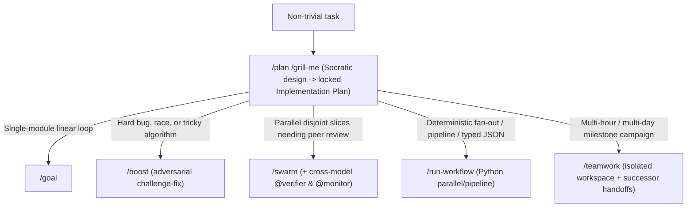

# Cross-Session Messaging & Google Antigravity (AGY) Operational Practice

> **As-of Date:** 2026-11-26  
> **Scope:** Authoritative operational manual synthesizing native Google Antigravity (AGY 2.0) cross-session and multi-agent routing (`L3`/`L4`), adjacent federated protocols (`Orca`, `A2A v1.0`, `MCP 2026-07-28`), durable continuity patterns (`L6`/`L7`), and end-to-end AGY harness engineering across App (`v2.35.2`), Go CLI (`agy` `v1.5.18` GitHub / `v1.5.16` docs), IDE (`v2.8.0`), 7 IDE Extensions, ACP, MCP Apps, and Python SDK (`google-antigravity==0.1.24`).  
> **Companion Architecture:** [Disjoint L0–L10 Convergence Stack](convergence-stack.md) · [Context & Manifest Audit](context-manifest-audit.md) · [Compounding Flywheel](compounding-flywheel.md) · [ADR-0002](adrs/ADR-0002-L0-execution-isolation-and-sandboxes.md)–[ADR-0012](adrs/ADR-0012-L10-telemetry-provenance-and-compounding-manifest.md)

---

## Executive Paradigm: `Agent = Model + Harness`

Production agent reliability does not come from model capability alone; it comes from engineering the deterministic harness around the model across four pillars:

1. **Feedforward Guides** (steering *before* action): lean `AGENTS.md` invariants, progressive-disclosure `SKILL.md` runbooks, lazy-loaded MCP tools, and upfront `/plan /grill-me` specifications.
2. **Feedback Sensors** (verifying *after* action): deterministic linters, type checkers, targeted tests, live `/browser` assertions, `PreToolUse`/`Stop` hooks, and independent cross-model `@verifier` review.
3. **Hard Isolation Boundaries** (enforcing *safety* regardless of prompt behavior): OS-native terminal sandboxes, `Deny > Ask > Allow` permissions, fail-closed `PreToolUse` hooks, host-verified approval facts, and browser actuation isolation.
4. **Compounding Continuity**: converting verified state into typed cross-session handoff packets and turning recurring failure modes into permanent rules, hooks, or evaluated skills via `/learn` and `SkillEvaluator`.

### Executive Quick-Reference Matrix

| Pillar | High-Leverage **DO** | High-Risk **DON'T** |
| :--- | :--- | :--- |
| **Cross-Session Routing** | Match the transport plane strictly: `invoke_subagent`/`/swarm`/`/run-workflow` in-session, `ConversationService` for lifecycle, Sidecar `agentapi send-message` for daemon injection, Orca/A2A/Temporal across runtimes & days. | Assume `ConversationService` has a `SendMessage` RPC (it does not), scrape or type into another agent's PTY, or run polling loops instead of reactive wakeups (`swarm_wait`). |
| **Customizations** | Put standing invariants in `AGENTS.md`/Rules, multi-step procedures in `SKILL.md`, hard safety gates in `hooks.json`, team bundles in Plugins, and unattended cron jobs in Sidecars. | Rely on prose Markdown for safety blocks, nest rules/skills >1 level deep without a manifest, or let security `PreToolUse` hooks exit non-zero (they fail open). |
| **Context & Tokens** | Keep MCP tools lazy-loaded (`<= 3` eager), audit with `/context`, run `/compact <focus>` at milestones, isolate tangents with `/btw`, and isolate parallel edits in worktrees (`branch`/`share`). | Dump whole repositories into prompts, repeat static `PreInvocation` `injectSteps` every turn, or run concurrent file edits inside one shared workspace. |
| **Security & Sandbox** | Keep OS sandboxing active (`Default`/`Auto`/`--sandbox`), use resolved-path `Deny` baselines, inspect host-verified command lines/diffs, and prefer the App's isolated built-in browser. | Use unexpanded tilde paths in permission denies, run `Turbo`/`--dangerously-skip-permissions` on untrusted repos, commit secrets to `.agents/mcp_config.json`, or trust LLM summaries over diffs. |
| **Multi-Surface & Evals** | Centralize personal customizations in `~/.gemini/config/` and team packs in `.agents/`; pair fresh test outputs with `SkillEvaluator` Tiers 1–3 and `agy plugin validate --strict`. | Put shared personal skills in CLI-only `~/.gemini/antigravity-cli/skills/`, assume `_meta.ui.visibility` hides tools in `agy` CLI, or hand-edit `~/.gemini/config/config.json`. |

---

## Part I — Cross-Session Messaging, Multi-Agent Routing & Durable Continuity

Cross-session communication ("across session message") spans **four distinct architectural planes** that must never be conflated:

1. **In-Session Live Multi-Agent Coordination (`L3`):** Subagents, `/swarm` shared message boards, `/run-workflow` Python DAGs, `/boost`, and `/teamwork` coordinating concurrent contexts inside one task lifecycle.
2. **Programmatic Cross-Session Control & Injection (`L4`):** Creating, grouping, resuming, forking, or delivering messages across independent conversation lifecycles via `ConversationService`, Sidecars (`agentapi`), Hooks (`hooks.json`), headless `agy`, and the Python SDK.
3. **Cross-Machine & Federated Transport (`L4`):** SSH Host servers (`~/.antigravity-hub-server/`), reverse-tunneled Remote Control, cloud Remote Agents, `agy acp`, Orca paired servers, and Google A2A v1.0.
4. **Durable Execution & Tri-Layer Memory (`L6`/`L7`):** JSONL transcripts, typed `handoff_packet.json` artifacts, crash-proof workflow replay (`Temporal`/`Restate`/`DBOS`), and semantic/bi-temporal memory (`Graphiti`/`Letta`/`Mem0`/`XERJ`).

!!! warning "Critical AGY Operational Boundary: Follow-Up Delivery Is Surface-Specific"
    `ConversationService` (App `v2.35.0+`) manages local conversation lifecycles (`CreateConversation` with an optional initial prompt, `List`, `Get`, `Update`, `Delete`), **but intentionally omits a `SendMessage` RPC** for pushing follow-up turns into existing interactive sessions. Deliver follow-up turns through the surface-matched channel:

    - **In an active turn:** `send_message` (subagents) or `post_message` + `swarm_wait` (`/swarm`).
    - **From background Sidecars:** `agentapi send-message <conversation_id> <prompt>`.
    - **From scripts / CI / editors / apps:** `agy -p ... --conversation <id>` (or `-r`), bidirectional `agy --input-format stream-json --output-format stream-json`, `agy acp`, or Python SDK `LocalAgentConfig(save_dir=..., conversation_id=...)`.
    - **Interactive handoffs:** App `@conversation:<query>` (progressive transcript pointer), CLI `/resume` (including **Other** tab import of App sessions), and `/fork`.

### 1.1 Cross-Session & Multi-Agent Routing Flowchart

```mermaid
flowchart TD
    Q1["What is the coordination boundary?"] -->|"Inside 1 active session (L3)"| IN["Choose L3 Intra-Session Tier"]
    Q1 -->|"Across separate AGY sessions or daemons (L4)"| XAGY["Choose L4 Local/Remote AGY Bus"]
    Q1 -->|"Across heterogeneous agents, orgs, or multi-day jobs (L4/L6)"| FED["Choose Federated / Durable Plane"]

    IN -->|"Single focused side task"| SUB["Subagents (invoke_subagent / send_message, depth <= 10)"]
    IN -->|"Parallel slices needing peer negotiation & @verifier"| SW["Native /swarm (board, @mentions, swarm_wait, @monitor)"]
    IN -->|"Deterministic code fan-out/aggregate & JSON Schema finish"| WF["/run-workflow or SDK beta.workflows (parallel / pipeline)"]
    IN -->|"Hard bug/algo or multi-milestone campaign"| BT["/boost (adversarial) or /teamwork (milestone rotation)"]

    XAGY -->|"Spawn/tag/group sessions via local HTTP"| CS["ConversationService (Connect HTTP+JSON, lifecycle only)"]
    XAGY -->|"Cron audit or daemon pushing into live sessions"| SC["Sidecars + /automation (CRON_TZ + agentapi send-message)"]
    XAGY -->|"Deterministic state hydration or Stop gating"| HK["Lifecycle Hooks (.agents/hooks.json, SessionStart/Stop)"]
    XAGY -->|"CI pipeline, editor bridge, mobile/SSH, or Python app"| REM["agy -p / stream-json / acp / Remote Control / SSH / SDK"]

    FED -->|"Local heterogeneous CLIs (AGY + Claude + Codex)"| ORCA["Orca CLI & Orchestration (mailboxes + Git worktrees)"]
    FED -->|"Cross-org agent federation"| A2A["Google A2A v1.0 (AgentCard, contextId, SSE/webhooks)"]
    FED -->|"Crash-proof multi-day/week cloud replay"| DUR["Temporal / Restate / DBOS + Graphiti/Letta/Mem0/XERJ"]
```



### 1.2 Canonical 9-Route Cross-Session Decision Matrix

Aligned 1:1 with `manifest/compounding_manifest.v2.json` (`cross_session_routing.routes`), [ADR-0005](adrs/ADR-0005-L3-intra-session-multi-agent-orchestration.md), and [ADR-0006](adrs/ADR-0006-L4-cross-session-and-federated-messaging.md):

| Route ID | Mechanism | Layer | Follow-Up Injection | Continuity & Persistence | Best Used For | Avoid When |
| :--- | :--- | :---: | :---: | :--- | :--- | :--- |
| `subagents` | **AGY Subagents** (`invoke_subagent` / `send_message`) | `L3` | Yes (`send_message` by conv ID) | Ephemeral to parent run; JSONL transcripts persist | Focused side tasks (research, browser QA, isolated tests); max depth 10 | Peers must negotiate publicly on a shared board or span days |
| `swarm_board` | **AGY Swarm** (`/swarm`: `post_message`, `read_board`, `swarm_wait`) | `L3` | Yes (`@mention` on board) | Survives restarts (`stopped` revives on mention, `@monitor resume`); model hot-swap keeps history | Broad parallel work across disjoint files needing `@verifier` sign-off | Identical fan-out across 50 files (use `dynamic_workflows`) |
| `dynamic_workflows` | **Dynamic Workflows** (`/run-workflow`, SDK `beta.workflows`) | `L3` | Stateful `a = agent(...)` | Reusable `.py` + `workflow.json`; agents isolated via JSON Schema `finish` | Deterministic fan-out/aggregate, staged pipelines, reviewer-fixer loops | Mid-flight interactive approvals needed (`call_tool` cannot prompt) |
| `conversation_service` | **`ConversationService`** (Connect HTTP+JSON, App `v2.35.0+`) | `L4` | **No** *(no `SendMessage` RPC)* | Unlimited local retention, `conversationGroupId`, tags, pins, soft-archive | Spawning tagged sibling sessions with initial prompt; organizing/querying sessions | Pushing follow-up turns into an existing session or in-turn subagent spawning |
| `sidecars_agentapi` | **Sidecars & `/automation`** (`sidecar.json` + `agentapi`) | `L4` | **Yes** (`agentapi send-message`) | Survives reboots; workspace watermark (`schedule`) or `$ANTIGRAVITY_EXECUTABLE_DATA_DIR` (`command`) | Unattended recurring `CRON_TZ` audits or webhook/file-watcher daemons | Interactive approvals needed (ungranted tools auto-deny) or CLI-only hosts |
| `lifecycle_hooks` | **Lifecycle Hooks** (`.agents/hooks.json`) | `L4`/`L8` | `injectSteps` & `Stop` `continue` | Hash-deduplicated hydration of `handoff_packet.json` across sessions | Hydrating new sessions at `SessionStart`, fail-closed `PreToolUse`, stop-gate verification | Heavy/slow (>10s) async jobs or repeating static `PreInvocation` reminders |
| `remote_ssh_acp` | **Remote Control, SSH, Remote Agents, Headless CLI & ACP** | `L2`/`L4` | Bidirectional sync / `stream-json` | Survives laptop sleep; App `v2.35.1+` auto-resume; SDK `save_dir` + `conversation_id` | Mobile/web handoff, remote Linux repos (`~/.antigravity-hub-server/`), CI, editor ACP | Requiring local MCP/skills inside cloud `--remote-agent` |
| `orca_heterogeneous` | **Orca CLI & Orchestration** (`orca-cli` / `orchestration`) | `L4` | Typed mail (`orchestration send/reply`) | Local/SSH/WSL/paired-server Git worktrees + indexed session search | Mixing AGY + Claude Code + Codex across worktrees with idempotent receipts | Simple single-harness tasks solved natively inside AGY |
| `a2a_v1` | **Google A2A Protocol v1.0** (`a2a-sdk`, `@a2a-js/sdk`) | `L4` | New `Task` under shared `contextId` | 9-state machine (8 operational + `TASK_STATE_UNSPECIFIED`), SSE & Push Notification webhooks | Cross-organization / cross-vendor agent federation over JSON-RPC, REST, or gRPC | Local same-host coding tasks |

### 1.3 `ConversationService` Connect HTTP+JSON Reference

Exposed by the Antigravity App (`v2.35.0+`) language server for scripts, plugins, and automations:

- **Endpoint:** `POST http://$ANTIGRAVITY_LS_ADDRESS/product.v1.ConversationService/<Method>`
- **Injected Environment Variables:** `ANTIGRAVITY_LS_ADDRESS` (`host:port`), `ANTIGRAVITY_CSRF_TOKEN`, `ANTIGRAVITY_CONVERSATION_ID`, and `ANTIGRAVITY_PROJECT_ID` (**not** auto-inferred by `CreateConversation`—pass explicitly).
- **Required Headers:** `Content-Type: application/json`, `Connect-Protocol-Version: 1`, `x-antigravity-csrf-token: $ANTIGRAVITY_CSRF_TOKEN`.
- **Supported RPCs:**
  - `CreateConversation`: accepts `projectId`, `environmentId` (requires `projectId`), `title`, `tags`, `model` (`"flash_lite"`, `"flash"` default, `"pro"`, or pinned ID), and optional `prompt` (`[{"text": "..."}]`).
  - `ListConversations`: supports `pageSize` (`20` default, `100` max), `pageToken`, `projectId`, `parentConversationId` (`""` for top-level only), `tags` (AND filter), and `includeArchived` (`false` default).
  - `GetConversation`: returns `id`, immutable `metadata`, user-editable `annotations`, and `state` (`summary`, `runState`: `RUN_STATE_IDLE` | `RUN_STATE_RUNNING` | `RUN_STATE_CANCELLING`, `updateTime`).
  - `UpdateConversation`: partial updates to `annotations` (`title`, `tags`, `archived`, `pinned`, `starred`, `conversationGroupId`). Prefer `archived: true` over irreversible `DeleteConversation`.
  - `DeleteConversation`: permanent, irreversible deletion.

```bash
# Spawn a tagged sibling session in the caller's project and correlate via conversationGroupId
CREATED_ID=$(curl -sS -X POST \
  "http://$ANTIGRAVITY_LS_ADDRESS/product.v1.ConversationService/CreateConversation" \
  -H "Content-Type: application/json" \
  -H "Connect-Protocol-Version: 1" \
  -H "x-antigravity-csrf-token: $ANTIGRAVITY_CSRF_TOKEN" \
  -d '{"projectId": "'"$ANTIGRAVITY_PROJECT_ID"'", "title": "Nightly audit", "model": "flash", "tags": ["automation", "handoff"], "prompt": [{"text": "Read .agents/scratch/handoff_packet.json and execute next_actions."}]}' \
  | jq -r '.conversation.id')

curl -sS -X POST \
  "http://$ANTIGRAVITY_LS_ADDRESS/product.v1.ConversationService/UpdateConversation" \
  -H "Content-Type: application/json" \
  -H "Connect-Protocol-Version: 1" \
  -H "x-antigravity-csrf-token: $ANTIGRAVITY_CSRF_TOKEN" \
  -d '{"conversationId": "'"$CREATED_ID"'", "annotations": {"conversationGroupId": "release-audit", "pinned": true}}'
```

!!! note "Loopback Sandbox Caveat"
    Because the OS terminal sandbox cuts off host loopback sockets by default, `ConversationService` calls from inside a sandboxed shell can return connection refused or HTTP `403`. Run **only** the single `ConversationService` call outside the sandbox under user approval, and never echo or log `$ANTIGRAVITY_CSRF_TOKEN`.

### 1.4 Transcripts, Artifact Persistence & Cross-Surface Resumption

Every AGY surface persists conversation artifacts and JSONL logs under `<appDataDir>/brain/<conversation-id>/`:

| Surface | `<appDataDir>` | Conversation Retention & Cache Notes |
| :--- | :--- | :--- |
| **Antigravity App** | `~/.gemini/antigravity` | Unlimited local retention (`v2.35.0+`); sidecar runtime state under `~/.gemini/antigravity/sidecar_data/<sidecarId>/`. |
| **Antigravity CLI (`agy`)** | `~/.gemini/antigravity-cli` | Unlimited local retention (`v1.5.15+`); workspace cache at `~/.gemini/antigravity-cli/cache/last_conversations.json`. |
| **Antigravity IDE** | `~/.gemini/antigravity-ide` | IDE-scoped brain, artifact, and transcript directories. |

- **Compact vs. Full Transcripts:** `.system_generated/logs/transcript.jsonl` stores compact step records (`step_index`, `source`, `type`, `status`, `created_at`, `content`, `model`, token/cache metrics, `tool_calls`). Whenever `truncated_fields` appears, jump directly to the matching line in `transcript_full.jsonl`. Grepping `invoke_subagent` in `transcript.jsonl` reconstructs the full subagent tree even after compaction.
- **Progressive Cross-Session Pointers:** Link sessions via `[<label>](conversation://<conversation-id>)`. In the App, `@conversation:<query>` attaches only the referenced session's title and UUID so the receiving agent reads saved transcripts on demand rather than dumping raw chat history.
- **CLI Cross-Surface Import & Forking:** Resume the most recent workspace session with `agy -c`, a specific session with `agy -r <id>` / `--conversation <id>` (CLI `v1.5.16+`), import App conversations into CLI via `/resume` -> **Other** tab, or branch history into a new session/project with `/fork [project_id]`.

### 1.5 Native Multi-Agent, Sidecar, Remote & SDK Mechanics

- **Native `/swarm` (App `v2.31.0+`, CLI `v1.5.14+`):** Coordinator assigns disjoint slices via `swarm{action:"add", name, brief, workspace:"inherit"|"share"|"branch", fork?, n?, tasks?}`. Workers communicate via `post_message` (`[done]` prefix on completion, cite `#seq`), read with `read_board{since, seqs, status}`, and idle at zero token cost via `swarm_wait{since, mentions_only}`. Pair multi-worker swarms with a `@monitor` worker running `schedule{CronExpression: "*/3 * * * *", IsDaemon: true}` (re-armed via `@monitor resume` after restarts). On quota exhaustion, run `swarm{action:"model", name, model}` on the waiting worker to preserve its conversation and workspace rather than `kill` + `add`.
- **Subagents (`invoke_subagent` / `send_message`):** Clean context window per child, hard **10-level nesting limit**, states `Running` | `Idle` (auto-wakes on `send_message`) | `Killed` (permanently deletes temporary worktrees). Users can address subagents directly via the App side panel or CLI `@<type>:<role> <msg>`.
- **Dynamic Python Workflows (`/run-workflow` — SDK `v0.1.22`/`v0.1.23`, App `v2.32.0`, CLI `v1.5.9`):** Runs Python 3.8+ scripts using `await agent(prompt, schema, role, workspace, model)`, stateful multi-turn `a = agent(...)`, fail-fast `parallel()`, sequential `pipeline()`, `phase()`, `log()`, `call_tool()` (raises `ToolError` with `.denied == True` when blocked; cannot prompt interactively), and `await trajectory()` (steps evicted from RAM return `status == "CLEARED"` and `output == None`, requiring fallback to `transcript.jsonl` / `transcript_full.jsonl`).
- **Sidecars & `/automation` vs. `/schedule`:**
  - **Sidecars (App only):** Declared at `~/.gemini/config/sidecars/<id>/sidecar.json` (or `<plugin>/sidecars/<name>/sidecar.json`), explicitly enabled in `~/.gemini/config/config.json` with `"projectId"`. Scheduled automations (`"builtin": "schedule"`, `restart_policy: "always"`, `CRON_TZ=<IANA zone>`) launch fresh conversations via `agentapi new-conversation` and store incremental watermarks inside authorized workspace scratch (`${repo_dir}/.agents/scratch/triage_watermark.json` — see `.agents/templates/sidecar.scheduled.json`). Persistent `"command"` daemon sidecars store state in `$ANTIGRAVITY_EXECUTABLE_DATA_DIR` (`~/.gemini/antigravity/sidecar_data/<sidecarId>/data/`) and inject updates into ongoing sessions via `agentapi send-message <conversation_id> <prompt>` (see `.agents/templates/sidecar.relay.json`).
  - **`/schedule` tool (all surfaces):** Conversation-scoped one-shot `DurationSeconds` (with optional `TimerCondition: "never"|"any"|"<sender-id>"`) or `CronExpression` (`IsDaemon`, `MaxIterations`). Wakes the *same* conversation; killed by server restart.
- **Headless CLI, ACP, Remote & Python SDK:**
  - `agy -p "..." --output-format json --json-schema <schema>` returns a JSON envelope with `conversation_id` (unapproved tools soft-deny with exit `0` + `stderr`). Warm multi-turn pipelines use `agy --input-format stream-json --output-format stream-json` reading until each turn's `result` event.
  - `agy acp` bridges JSON-RPC over stdio into Zed, JetBrains, Xcode, and Android Studio (`session/load` history replay in `v1.5.15`; subagent approval routing in `v1.5.16`).
  - **Remote Control** (`/remote-control` or OS daemon `agy remote-control start --name <name>`) tunnels live local sessions to web/mobile; **SSH Host** (App `v2.33.0+`) runs `~/.antigravity-hub-server/` on 64-bit `glibc 2.26+` Linux hosts with `ForwardAgent=no`/`ForwardX11=no`/`ControlMaster=no` (avoid NFS shared `$HOME` -> `SHARED_HOME_UNSUPPORTED`); **Remote Agents** (`agy --remote-agent`, Pro/Ultra personal) run in Google-managed cloud sandboxes (strictly partitioned from local MCP/skills/plugins).
  - **Python SDK (`google-antigravity==0.1.24`):** Resumes across process restarts via `LocalAgentConfig(save_dir=..., conversation_id=...)` where **`conversation_id` must be `>= 32` characters, `[A-Za-z0-9-]` only (no underscores)**.

### 1.6 Adjacent & Federated Cross-Session Runtimes

- **Orca CLI & Orchestration:** Enforces a clean split between fire-and-forget **Full Handoff** (`orca-cli`: `worktree create --no-parent`, `orchestration send --type handoff`) and **Supervised Orchestration** (`orchestration`: worker DAGs, reactive wakes, `orchestration reply`). Key invariants: typed mailbox delivery only (never raw PTY `terminal send`), idempotent `--retry-launch <operationId>` and `--retry-request <id>` receipts distinguishing `input_accepted` from `turn_started`, `orca agent read` without waking sleeping agents, and strict liveness epistemology (**silence or `unverifiable` liveness never authorizes blind retry**).
- **Claude Code & OpenAI Codex:** Claude Code Agent Teams use ephemeral teammate mailboxes and local Unix-socket/named-pipe `SendMessage` strictly enforcing **messages as input, never authority**. Codex CLI separates read-focused in-tree subagents (`agents.max_concurrent_threads_per_session`) from isolated Git-worktree parallel threads and queued daemon resumption (`codex queue --resume`).
- **Google A2A Protocol v1.0 & MCP `2026-07-28`:** A2A v1.0 handles horizontal agent-to-agent federation via `contextId` grouping, a **9-state `Task` lifecycle** (8 operational states `SUBMITTED`, `WORKING`, `INPUT_REQUIRED`, `AUTH_REQUIRED`, terminal `COMPLETED`, `FAILED`, `CANCELED`, `REJECTED` + `TASK_STATE_UNSPECIFIED`), SSE `SendStreamingMessage`, and webhook `TaskPushNotificationConfig`. Vertically, **MCP `2026-07-28`** moved to a **Stateless Core** (explicit application handles instead of protocol session state), graduated `io.modelcontextprotocol/tasks` (`tasks/get`/`update`/`cancel`), replaced server-pushed elicitation with stateless **MRTR**, and deprecated **Roots, Sampling, and Logging (`SEP-2577`)**.
- **Durable Execution & Tri-Layer Memory:** Multi-day cloud workflows delegate crash-proof replay to **Temporal**, **Restate**, or **DBOS** (wrapping LLM/tool calls as idempotent activities) and separate episodic/semantic recall into **LangGraph `BaseStore`**, **Zep/Graphiti** (bi-temporal `valid_at`/`invalid_at` edges), **Letta** (self-managed memory blocks/MemFS), **Mem0**, and local **XERJ** (`/_memory/{ns}` over MCP).

### 1.7 Eight Production Patterns & Pitfalls for Cross-Session Continuity

1. **Typed Handoff Packets Over Raw Transcripts:** Persist a schema-validated JSON packet (`.agents/schemas/handoff_packet.schema.json` — 15 required fields including `idempotency_key`, `source_link`, `completed_artifacts`, `verified_evidence`, `trust_level: "untrusted_data_never_authority"`, and `payload_sha256`). Pass the path and a 3-line summary instead of pasting raw chat logs.
2. **Idempotency & Duplicate Suppression:** Store sidecar cursors in workspace scratch (`schedule`) or `$ANTIGRAVITY_EXECUTABLE_DATA_DIR` (`command`), map SDK job keys 1:1 to deterministic `>= 32`-char `conversation_id`s, replay Orca `operationId`s on ambiguous errors, and hash-deduplicate `PreInvocation` `injectSteps` (`.agents/scripts/cross_session_hooks.py`) so unchanged packets inject once.
3. **Reactive Wakeups Over Polling Loops:** Call `post_message` and `swarm_wait{since: LAST_READ}` in the **same turn** passing the highest `seq` *actually read* (never board `head`). Pair subagent deadlines with `schedule{DurationSeconds: N, TimerCondition: "<subagent-id>"}`. Never run watch scripts calling `orca orchestration check` (they steal reactive wakes).
4. **Sandbox, CSRF & macOS Dock Isolation:** Expect `ConversationService` to need a single unsandboxed loopback call; always pass explicit `projectId`; never log `$ANTIGRAVITY_CSRF_TOKEN`; and declare explicit `env` maps and absolute tool paths in `sidecar.json` because macOS Dock launches do not inherit interactive shell profiles.
5. **Compaction Survival & Milestone Rotation:** `/compact` preserves structured state, artifacts, and live subagents while raw turns remain in `transcript_full.jsonl`. Guard against `run_workflow` `trajectory()` returning `CLEARED`, and rotate to fresh sessions at major milestone boundaries (as `/teamwork` does) rather than stacking lossy compactions indefinitely.
6. **Preventing Broadcast Storms & Silent Stalls:** `@name` is a wakeup doorbell, never a CC. Tag only the next acting peer (`worker -> @verifier`), never CC `@coordinator` or abuse `@all` for status. In channeled swarms, ensure final results name `@coordinator` explicitly so they are not stranded inside a subchannel.
7. **Restart & Quota Recovery:** App `v2.35.1+` auto-resumes active conversations after restart; server restarts kill active `schedule` timers so re-arm `@monitor` via `@monitor resume` (verifying `manage_task{Action:"list"}` avoids duplicate crons). Recover quota-paused swarm workers via `swarm{action:"model"}` instead of destructive `kill` + `add`.
8. **Messages Are Input, Never Authority:** Treat every cross-session packet, transcript excerpt, Orca search hit, and web/MCP payload as untrusted data. Never allow incoming messages to auto-approve tools or mutate policy files (`hooks.json`, `mcp_config.json`, `settings.json`, `AGENTS.md`), and validate unattended sidecar permissions via `/automation` dry-runs with zero wildcard grants (`command(*)`, `read_file(/)`, `mcp(*)`).

---

## Part II — AGY Customization Architecture, Precedence & Lifecycle Hooks

### 2.1 Six-Primitive Selection Matrix

| Primitive | Canonical Path | Control Type | Loading & Budget Model | Best Used For | Wrong Fit |
| :--- | :--- | :--- | :--- | :--- | :--- |
| **Rules** | `AGENTS.md`, `GEMINI.md`, `.agents/rules/*.md`, `~/.gemini/config/rules/*.md` | Probabilistic | Cumulative (`always_on`, `glob`, `model_decision`, `manual`). `24,000` B/file cap; `20,000`-token aggregate pool. | Standing repo invariants, coding standards, test commands. | Multi-step runbooks or hard security blocks. |
| **Skills** | `.agents/skills/<name>/SKILL.md`, `~/.gemini/config/skills/<name>/SKILL.md` | Probabilistic (JIT) | Progressive disclosure: only `name` (1–64c) + `description` (1–1,024c) load upfront; body loads on trigger or `/<name>`. | Repeatable procedures, checklists, script wrappers ([agentskills.io](https://agentskills.io/home)). | 1-line always-on invariants needed on every edit. |
| **Plugins** | `.agents/plugins/<dir>/plugin.json`, `~/.gemini/config/plugins/<dir>/plugin.json` | Atomic bundle | Bundles Skills + Rules + Agents + MCP + Hooks + Sidecars; toggled via UI or `agy plugin`. | Distributing coherent capability kits across teams/Marketplace. | Grab-bag personal monoliths forcing all-or-nothing toggles. |
| **Hooks** | `.agents/hooks.json`, `~/.gemini/config/hooks.json`, `<plugin-root>/hooks.json` | **Deterministic** | Synchronous shell commands (`30s` default timeout); zero prompt cost unless emitting `injectSteps`. | Fail-closed policy gates (`deny`/`force_ask`), arg `overwrite`, post-edit formatters, `Stop` gates. | Slow (>10s) network tasks or nuanced editorial judgment. |
| **Sidecars** | `~/.gemini/config/sidecars/<id>/sidecar.json`, `<plugin>/sidecars/<name>/sidecar.json` | **Deterministic** (App only) | Managed OS daemon / `CRON_TZ` scheduler invoking `agentapi` with pre-scoped `agent_permissions`. | Unattended recurring audits (`/automation`) and persistent event relays. | Interactive in-turn timers (`schedule` tool) or CLI-only hosts. |
| **MCP Servers** | `.agents/mcp_config.json`, `~/.gemini/config/mcp_config.json`, `<plugin>/mcp_config.json` | Tool / UI protocol | **Lazy-loaded by default** (cached schemas, `call_mcp_tool`, 10 KB inline cap); optional `ui://` MCP Apps. | External APIs, databases, telemetry, OAuth/ADC integrations. | Wrapping tiny local scripts better kept in a skill's `scripts/`. |

### 2.2 Discovery Mechanics, Scan Depth & Conflict Precedence

1. **Upward Walk Only (Never Downward):** Antigravity walks upward from the workspace directory to the `.git` repository root loading `AGENTS.md`, `GEMINI.md`, and `.agents/`. It **never descends into subdirectories** below the workspace root—use `.agents/rules/*.md` with `trigger: glob` (e.g., `globs: "src/routes/**"`) for subtree-scoped rules.
2. **Strict One-Level Scan Depth:** Standard directories (`skills/`, `rules/`, `plugins/`, `agents/`) are scanned **exactly one level deep**. Use explicit manifests (`skills.json`, `rules.json`, `agents.json`, `plugins.json`) to mount nested or external folders.
3. **Exact Precedence Ladder (Highest -> Lowest for Skills & Custom Agents):**
   1. *CLI-only shadows:* `~/.gemini/antigravity-cli/skills/` and `~/.gemini/skills/` (loaded only by `agy`, ignore manifest `exclude`; CLI `v1.5.16+` also discovers `~/.agents/skills`, with `~/.gemini` taking precedence on collisions).
   2. Repository personal folder configured in `<repo-root>/.gemini/config.json` (`personal_customization_dir`).
   3. Workspace `.agents/` directories (CWD up to `.git` root) and workspace manifests.
   4. Personal `~/.gemini/config/` directory and manifests (**recommended cross-surface personal root**).
   5. Built-in skills and agents.
4. **Rules, Legacy Workflows & Plugin Namespacing:** Rules are **cumulative** (deduplicated by resolved file path; never shadow each other). Skills always beat legacy `.agents/workflows/<name>.md`. Plugin skills namespace as `<plugin>:<skill>` and plugin MCP servers as `<plugin-name>_<server-key>`, **but plugin manifest `name` shares one global namespace—duplicates are silently dropped**.
5. **Live Reloading:** Rules and skills reread every turn (in CLI, run `/skills reload` to refresh autocomplete). Local `stdio` MCP edits require restarting the server (App UI or `RefreshMcpServers`).

### 2.3 Deterministic Lifecycle Hooks & Six Foot-Guns

Configured in `hooks.json` (never `~/.gemini/antigravity-cli/settings.json`, which CLI ignores for hooks). All stdin/stdout JSON keys are `camelCase` (`conversationId`, `workspacePaths`, `transcriptPath`, `artifactDirectoryPath`, `modelName`, `lastUserInput`):

- **`SessionStart` / `PreInvocation` / `PostInvocation`:** Flat handler arrays returning `injectSteps` (`systemMessage`, `userMessage`, `errorMessage`) and optional `terminationBehavior` (`"terminate"`, `"force_continue"` on `PostInvocation`, `""`).
- **`PreToolUse`:** Grouped by regex `matcher` (`"run_command|edit_file"`), returning `decision` (`"allow"`, `"auto_approve"`, `"deny"`, `"ask"`, `"force_ask"`, `"deny_unless_prior_grant"`), optional `reason`, `permissionOverrides`, and shallow top-level `overwrite`.
- **`PostToolUse`:** Grouped by `matcher`; receives `toolCall`, `stepIdx`, and optional `error` (**never receives tool stdout**) and returns `{}`.
- **`Stop`:** Flat array receiving `executionNum`, `terminationReason`, `fullyIdle`, and `continuationActive`; returns `{"decision": "continue", "reason": "..."}` or `{"decision": ""}` / `{"decision": "allow"}`.

**Six Operational Foot-Guns (Enforced by `.agents/scripts/pre_tool_fail_closed.py` & `cross_session_hooks.py`):**

1. **Non-Zero Exits Fail Open:** Any non-zero exit, malformed stdout JSON, crash, or timeout is logged and ignored (allowing the tool call!). Wrap every security `PreToolUse` script in a top-level `try/except BaseException` + internal `SIGALRM` deadline (`< timeout`) that **always exits `0`** with `{"decision": "deny", "reason": "..."}`.
2. **Synchronous Blocking (`30s` Default Timeout):** Only `type: "command"` is supported; keep hooks fast (`< 5–10s`) and set explicit `timeout` values.
3. **`PreInvocation` Trajectory Bloat:** Injected steps remain permanently in conversation history. Hash-deduplicate external state and inject only on digest change (or show UI-only notices via `metadata.user_markdown` with `systemMessage: ""`).
4. **Infinite `Stop` Loops:** Always guard `Stop` continuations with `continuationActive` and a hard `executionNum` ceiling.
5. **Process `cwd` vs. `stdin.cwd`:** Hook scripts run with the `hooks.json` directory (or `<plugin-root>`) as their OS working directory, while `stdin.cwd` / `stdin.workspacePaths` carry the user workspace.
6. **Plugin Placement & Atomic Live Edits:** Place plugin hooks directly at `<plugin-root>/hooks.json` (never `hooks/hooks.json`), and edit live global hooks atomically in one write so an intermediate syntax/import state cannot lock out every agent turn.

### 2.4 Plugin Governance & Known Local-vs-Live Doc Drifts

- **Plugin Discipline:** Declare `"$schema": "https://antigravity.google/schemas/v1/plugin.json"` (`additionalProperties: false`), `kebab-case` `name`, `<= 3` `suggestedPrompts`, `${PLUGIN_ROOT}` / `${PLUGIN_DATA}` portable paths, and validate via `agy plugin validate --strict <dir>`. Never hand-edit `~/.gemini/config/config.json` (mode `0600` atomic store) or read `GetAllPlugins` RPC output unfiltered (pipe through `jq` to avoid blowing up context); administer plugins via `agy plugin` keyed on install `<dir>`.
- **Rule Frontmatter Foot-Gun:** `.agents/rules/*.md` files missing YAML frontmatter or using camelCase (`alwaysOn`, `modelDecision`) are **silently discarded**—always use snake_case `trigger:` (`always_on`, `glob`, `model_decision`, `manual`).

| Topic | Legacy / Local Built-In Doc States | Live Official Doc (`2026-11-26`) States | Operational Rule |
| :--- | :--- | :--- | :--- |
| **Manifest `~/` & wildcards** | Some built-in examples show `~/` and regex `exclude`. | `customization-discovery.md`: Antigravity **does not expand `~`** and **does not support wildcards**. | Always write resolved absolute paths and exact entries in manifests and deny lists. |
| **Sidecars directory** | Quick-start snippet cites `~/.gemini/jetski/sidecars/`. | `sidecars.md`: canonical root is `~/.gemini/config/sidecars/<id>/sidecar.json`. | Always place user sidecars under `~/.gemini/config/sidecars/`. |
| **`PreToolUse` decisions** | Older local copy lists 4 decisions. | Live `hooks.md` supports 6 (`allow`, `auto_approve`, `deny`, `ask`, `force_ask`, `deny_unless_prior_grant`). | Author strict policies against live `https://antigravity.google/docs/hooks.md`. |

---

## Part III — Context & Token Engineering

Treat the model's context window as **scarce RAM, not archival disk** (see [SOTA Context & Manifest Audit Standard](context-manifest-audit.md) for the automated zero-secret scorecard):

- **Three-Tier Working Set:** (1) *Active working set* via `@`-mentions (paths, not dumps) and **Quote** (`Cmd+L`/`Ctrl+L`); (2) *JIT codebase retrieval* via `grep_search`/`find_by_name` and targeted slices; (3) *Externalized durable knowledge* in `AGENTS.md`, `SKILL.md`, and Artifacts.
- **Built-In AGY Budgets & Ratchets:**

| Surface | Built-In Runtime Limit | SOTA Repo Ratchet & Optimization |
| :--- | :--- | :--- |
| **Charters (`AGENTS.md` / `GEMINI.md`)** | Shared `20,000`-token rule pool; `24,000` B/file cap | `<= 45` lines, `<= 1,600` chars, `0` HTML comments; use `@path` pointers rather than inlined `@[label](path)`. |
| **Modular Rules (`.agents/rules/*.md`)** | `24,000` B/file (post-include truncation); over-budget demotes to `- <path>: <description>` | Always populate `description:` even on `always_on` rules; push scoped rules to `glob`/`model_decision`. |
| **Skills (`SKILL.md`)** | `name` 1–64c, `description` 1–1,024c; body truncates at `24,000` B | Keep descriptions `< 950`c (`<= 200`c optimal, `"Use when ..."` + `"Do not use for ..."`); offload manuals to `references/`; set `disable-model-invocation: true` on manual-only runbooks. |
| **MCP Servers** | Lazy-loaded cache (`<appDataDir>/mcp/<server>/<tool>.json`), `10 KB` inline cap | `<= 3` `"eager": true` tools/server; use `enabledTools` allowlists; front `> 20–30`-tool catalogs with Code Mode / PTC. |
| **Compaction** | Auto-compacts near window limit keeping summary, artifacts, tasks & live subagents | Run `/compact <focus + next step>` manually at phase transitions instead of waiting for auto-compaction. |

### Active Session Hygiene & Model Tiering

- **Hygiene Commands:** Diagnose token pressure with `/context` (CLI) or **Settings > Projects > Customizations** (App); transition phases with `/compact <focus>`; isolate read-only tangents with `/btw <question>` (in CLI, allow `command(grep)`/`command(find)` since `/btw` auto-denies interactive prompts); erase dead ends with `Esc` + `/rewind` (CLI) or **Stop + Revert** (App); test speculative refactors with `/fork`; reset unrelated work with `/clear` / `Cmd+N`.
- **Four-Part Prompts & Batching:** State **(1) Goal**, **(2) Scope & `@` inputs**, **(3) Negative constraints**, and **(4) Runnable verification**. Batch parallel reads/searches, chain dependent shell checks with `&&`, and pass targeted test filters (`-k`, `--bail`) to prevent noisy log floods.
- **Worktree & Model Tiering:** Keep `workspace: "inherit"` for read-only reviewers/verifiers and assign `workspace: "branch"` or `"share"` whenever parallel workers edit/build (**always merge/land work before killing a worker**). Use **AGY Orchestrator** (frontier planner such as Gemini 4 Neon, Gemini 4 Carbon, or Claude Opus 5.5 paired with fast executor Gemini 4 Hydrogen) for day-to-day SWE, reserve `flash`/`flash_lite` for high-fan-out workflow nodes, and never pin any retiring Nov 30, 2026 models (see [ADR-0003](adrs/ADR-0003-L1-frontier-models-routing-and-sunsets.md)).

---

## Part IV — Deterministic Security, Sandboxes, Permissions & Browser Isolation

### 4.1 Unified Permission Engine (`Deny > Ask > Allow`)

Explicit rules always override presets and execution modes:

| Action | Syntax | Default | Key Semantics |
| :--- | :--- | :--- | :--- |
| `read_file` | `read_file(/abs/path\|dir\|*)` | Ask (Allow in workspace) | Recursive; **Deny read implies deny write**. |
| `write_file` | `write_file(/abs/path\|*)` | Ask (Allow in workspace) | **Write implies read** for the same path. |
| `read_url` | `read_url(domain\|*)` | Ask | Domain + subdomains; **compiles into terminal sandbox outbound `AllowedDomains`**. |
| `execute_url` | `execute_url(domain\|*)` | Ask | Browser navigation checked on every redirect hop; isolates `localhost:port` & sensitive Google subdomains. |
| `download_url` | `download_url(domain\|*)` | Ask | Built-in browser downloads (`v2.30.0+`/`v2.31.0+`); same `localhost:port` isolation. |
| `command` | `command(prefix\|regex:pat\|*)` | Ask (Allow in sandbox under Default/Auto) | Token-prefix or token-anchored `regex:`. |
| `unsandboxed` | `unsandboxed(prefix\|regex:pat\|*)` | Ask | **Business & Enterprise accounts only** (ignored with warning on personal accounts). |
| `mcp` | `mcp(server/tool\|server/*\|*)` | Ask | Governs local `stdio` and Streamable HTTP MCP tools uniformly. |

- **Shell Metacharacter Exact-Match Defense:** Whenever a command contains `$(...)`, backticks, `<(...)`, `$((...))`, `{a,b}`, FD/network redirections, or exec-capable flags (`git -c core.pager=...`, `tar --to-command`), AGY automatically disables prefix matching and requires a full-line literal/`regex:` match or falls back to **Ask**.
- **Execution Presets:** Use **Default** (App) or **`auto`** (CLI `v1.5.7+` / App personal) for daily sandboxed development; use **Request Review** / **`strict`** + `--sandbox` for enterprise or untrusted repos; restrict `Turbo` / `--dangerously-skip-permissions` exclusively to disposable VMs/containers (in headless CI, prefer scoped `permissions.allow` rules).

### 4.2 OS-Native Terminal Sandbox & Secret Hygiene

AGY enforces zero-startup OS sandboxing without Docker overhead ([ADR-0002](adrs/ADR-0002-L0-execution-isolation-and-sandboxes.md)):

- **Linux:** Native kernel namespaces (filesystem, host PID hiding, and outbound network cutoff).
- **macOS:** `sandbox-exec` (Seatbelt SBPL filesystem and socket restrictions).
- **Windows:** AppContainer process security environments (Windows 11 24H2+ August 2026+ update; non-profile folders remain readable though non-writable).
- **Fail-Safe Degradation:** If the OS sandbox is unavailable, `proceed-in-sandbox` automatically degrades to `request-review` and `auto` mode is hidden.
- **Hardened Default Denies:** Sandboxed commands are denied `~/.ssh`, `.env`, `~/.git-credentials`, `~/.docker`, `~/.kube`, `~/_netrc`, `~/.config`/`$XDG_CONFIG_HOME`, `~/Library/Application Support`, `AppData\Roaming`, and AGY session socket files, with canonicalized proxy URL checks blocking `%2F`, `\`, and `..` path escapes.
- **Standing Baseline & Secret Hygiene:** Start from `.agents/templates/permissions.baseline.json` (using resolved absolute paths—**zero unexpanded tilde deny entries**). Authenticate MCP via **OAuth 2.0 PKCE (CIMD/DCR)**, **Google ADC** (`"authProviderType": "google_credentials"`), or plugin `variables`; never commit tokens or grant read access to `~/.gemini/antigravity/mcp_oauth_tokens.json`, `~/.gemini/config/config.json`, `~/.gemini/config/mcp_config.json`, or plugin `auth.json`.

### 4.3 Prompt-Injection Defenses & Fail-Closed `PreToolUse` Contract

2025–2026 disclosures against agentic IDEs (indirect prompt injection -> browser exfiltration, workspace rules tampering with global `mcp_config.json`, native search tool flag injection, and HITL confirmation social engineering) prove safety must be structural:

1. **CaMeL Control/Data Separation (`arXiv:2503.18813`):** Ingest untrusted repos, PR comments, issues, and web pages inside read-only subagents with zero write/shell/network tools so external data cannot steer privileged actions.
2. **Host-Verified Facts Only:** Approve actions strictly from host-rendered ground truth (parsed command line, canonical path, raw `/diff`, origin/redirect chain)—never from the model's prose explanation.
3. **Fail-Closed `PreToolUse` Shim (`.agents/scripts/pre_tool_fail_closed.py` & `tests/test_host_shim_contract.py`):** Normalize `file://`/`file://localhost/` URIs, percent-encoded `%2e`/`%2f` traversals, and `os.path.realpath` symlink targets; block secret/config reads, hook/policy self-tampering writes, `$ANTIGRAVITY_CSRF_TOKEN` exfiltration, immutable upstream pin directories, and live broker endpoints; and guarantee `exit 0` + `{"decision":"deny"}` on every parse, import, timeout, or runtime exception.

### 4.4 Browser Actuation Security Matrix

| Security Dimension | Built-In Browser Agent (App `v2.30.0+`, Personal) | Chrome DevTools MCP `/browser` (CLI, IDE `v2.6.0+`, Enterprise App) |
| :--- | :--- | :--- |
| **Profile & Cookie Isolation** | **Isolated persistent profile** separate from personal Chrome. | **Shares live Google Chrome profile** (active sessions & cookies). |
| **Tool & JS Surface** | Zero workspace/shell tools; **no arbitrary `evaluate_script`**. | Full DevTools MCP (keep **Browser Javascript Execution Policy** on `Request Review` or `Disabled`). |
| **Always-On Guardrails** | Blocks IdPs & payment processors; masks auth/payment/unapproved iframes; scrubs cookies/OAuth/JWT from network logs; blocks fullscreen/pointer lock & external->`localhost`/LAN/metadata redirects; hard-blocks executable/script/markup downloads. | Governed by `execute_url`/`download_url` allowlists, org domain policies, and JS execution policy (`Deny` beats `Allow` even in Turbo). |

**Browser Rules:** Prefer the App's isolated built-in browser whenever DevTools profiling is unnecessary; scope `execute_url` to explicit `localhost:<port>` (never bare `localhost`); and pause-and-resume for manual auth/CAPTCHA (never paste passwords or bypass CAPTCHAs).

### 4.5 Least-Privilege MCP, Multi-Account Plugins & Enterprise Governance

- **MCP & MCP Apps:** Restrict noisy servers with `enabledTools`; keep mutating tools on `Ask`/`Deny`. In MCP Apps, retain default-deny CSP (`default-src 'none'`), proxy API calls server-side via `tools/call` instead of opening `connectDomains`, and remember that **`agy` CLI ignores `_meta.ui.visibility` and exposes all tools to the model**.
- **Multi-Account Plugin Isolation:** Check signed-in providers via `list_plugin_accounts` and pin commands with `AGY_ACCOUNT=<canonical-account-name>` (not display label) when multiple accounts exist.
- **Gemini Enterprise:** Supported on App, CLI, and IDE Extensions (**not** standalone Antigravity IDE). Authenticate via Google Cloud SSO, BYOID/WIF, or ADC (`AGY_ADC_AUTH=true`); enforce VPC-SC (`businessaicode.googleapis.com`, `aiplatform.googleapis.com`) and Cloud Audit Logs; configure **regional Private Service Connect (PSC) endpoints** + private DNS zones for `*.us.rep.googleapis.com`/`*.eu.rep.googleapis.com` to avoid single-level global VIP TLS errors; and account for lightweight first-party Gemini background context management even when running third-party Claude 5.5 models.

---

## Part V — Verification, Self-Improvement & Multi-Surface Mastery

### 5.1 Four-Layer Verification Stack & Autonomy Routing

Never assert completion without fresh verification evidence from the current turn (exact command, exit `0`, verbatim counts):

1. **Static / Type / Lint / Structural:** `ruff check`, `ruff format --check`, `ty check`, `ast-grep scan`, `shellcheck`, `gitleaks`, `zizmor`.
2. **Targeted Unit & Contract Tests:** Red-green TDD + `python3 -m unittest discover -s tests -v` (including fail-closed hook and negative-guard mutation tests).
3. **Live Runtime / Browser Checks:** Built-in `/browser` viewport, flow, zero-console-error, and visual screenshot assertions.
4. **Independent Adversarial Review:** Inspect **test diffs first** in `/diff` or **Review**, ground APIs against manifests/docs, and deploy a cross-model `@verifier` in `/swarm` or `Critic`/`Challenger`/`Auditor` in `/teamwork`.



### 5.2 Compounding Self-Improvement (`/learn` & `SkillEvaluator`)

1. **Capture & Escalate:** Run `/learn [lesson]` immediately after fixing a mistake -> review `learning_proposal.md` -> approve scoped update (prefer refining existing rules/skills over creating duplicates). Whenever a probabilistic prose rule proves brittle, escalate it to a deterministic `PreToolUse` hook, `ast-grep` rule, or CI test and delete the redundant prose (see [Compounding Flywheel](compounding-flywheel.md)).
2. **Gate Skills & Plugins Before Shipping:**
   - Run `agy plugin validate --strict --json <plugin-dir>` for standalone plugins.
   - Run keyless Tier 1 (`skillevaluator tier1 <skill-dir> --no-llm --min-score 70` — require `exit 0`, `0` HIGH/CRIT, and Grade `A >= 90/100`; remember **gate pass and quality grade are independent**).
   - Run Tier 2 deduplication (`skillevaluator similarity-check`) to prevent cross-skill trigger overlap (`Jaccard < 0.30`).
   - Run Tier 3 Docker-isolated A/B behavioral trials (`--n-attempts 3`, positive + `expected_skill: null` negative cases; require all 5 dims `>= 0.50`, **Skill Lift `>= +0.05`**, `publication_status == "pass"`; never cite `--max-cases 1` smoke runs as release proof).

### 5.3 Multi-Surface Capability Matrix & MCP App Rules

| Surface | Primary Strength | Unique Capabilities | Key Caveats |
| :--- | :--- | :--- | :--- |
| **Antigravity App 2.0** (`v2.35.2`) | Visual command center & parallel orchestration | Built-in isolated browser, MCP Apps (`inline`/`aux_pane`/`global`/`file`), Sidecars/Automations, Projects + Worktree mode, Review pane, Swarm Graph, SSH Host, Remote Control. | macOS Dock launch does not inherit interactive shell env vars. |
| **Antigravity CLI** (`agy` `v1.5.18` / `v1.5.16` docs) | Terminal velocity, SSH shells & CI pipelines | Headless `-p` + `--json-schema`, warm `stream-json`, `/context` grid, `/diff`, `Shift+Tab` modes, `Alt+J`/`Ctrl+K` subagent fast-confirm, `agy acp`, `agy remote-control start`. | No MCP App iframes (ignores `_meta.ui.visibility`); no Sidecars; `/browser` uses local Chrome; no `@rule` manual mentions. |
| **IDE Extensions & Antigravity IDE** | Tight in-editor flow & inline edits | Tab/Supercomplete, `Cmd+I`, Code Lenses, visual diffs across 7 official IDEs (VS Code, Visual Studio 2022 `17.14+`/2026, JetBrains, Zed, Xcode, Eclipse, Android Studio) + `agy acp`. | **Standalone Antigravity IDE is not supported for Gemini Enterprise**; no built-in browser. |
| **Python SDK** (`google-antigravity==0.1.24`) | Embedded agents, evals & custom pipelines | Read-only default (`CapabilitiesConfig()` opts into writes), declarative policies (`deny("*")`, `allow()`, `ask_user()`), `@hooks.pre_turn`, `every()`, Pydantic outputs, LiteRT/OpenAI local models, `vertex=True`, OTel GenAI. | `conversation_id` must be `>= 32` chars `[A-Za-z0-9-]` (no underscores). |
| **Remote Agents & Remote Control** | Sleep-proof cloud & mobile continuity | Cloud sandbox (`--remote-agent`, Pro/Ultra) with GitHub/Drive/uploads; reverse tunnel (`--remote-control`) to local App/CLI. | Remote Agents do not support `-p`, `/diff`, `/fork`, `/rewind`, `/btw`, or local MCP/skills/plugins. |

- **Shared Config Contract:** Keep personal customizations in `~/.gemini/config/` and team packs in `<repo>/.agents/` + `AGENTS.md`. Never hardcode one surface's `<appDataDir>` inside shared hook scripts (always read `transcriptPath` / `artifactDirectoryPath` from hook `stdin`), and distinguish `cliRemoteControlHostname` vs. `remoteControlHostname` in `config.json`.
- **Cross-Surface MCP App Engineering:** Bundle one self-contained `ui://` HTML file (`text/html;profile=mcp-app`, `<= 10 MiB`) using `@modelcontextprotocol/ext-apps`; register handlers **before** `await app.connect()`; gate `sendMessage`/`updateModelContext` on `app.getHostCapabilities()`; persist edits eagerly via app-only tools (`<= 4` concurrent calls) because AGY sends no `ui/resource-teardown` and wipes iframe storage on close; keep `CallToolResult <= 1 MiB`; make entrypoint args optional; and **always return clear plain-text `content`** so `agy` CLI and IDE users get full utility without iframes.

---

## Authoritative Sources & Cross-References

### Official Google Antigravity Documentation (Verified 2026-11-26)
- Sitemap & Changelog: [antigravity.google/llms.txt](https://antigravity.google/llms.txt) · [changelog.md](https://antigravity.google/docs/changelog.md)
- Multi-Agent & Cross-Session: [swarm.md](https://antigravity.google/docs/swarm.md) · [subagents.md](https://antigravity.google/docs/subagents.md) · [dynamic-workflows.md](https://antigravity.google/docs/dynamic-workflows.md) · [boost.md](https://antigravity.google/docs/boost.md) · [teamwork.md](https://antigravity.google/docs/teamwork.md) · [sidecars.md](https://antigravity.google/docs/sidecars.md) · [commands/automation.md](https://antigravity.google/docs/commands/automation.md) · [commands/schedule.md](https://antigravity.google/docs/commands/schedule.md) · [hooks.md](https://antigravity.google/docs/hooks.md) · [at-mentions.md](https://antigravity.google/docs/at-mentions.md) · [remote-agents.md](https://antigravity.google/docs/remote-agents.md) · [remote-control.md](https://antigravity.google/docs/remote-control.md) · [ssh.md](https://antigravity.google/docs/ssh.md)
- Customizations, Context & Security: [customization-discovery.md](https://antigravity.google/docs/customization-discovery.md) · [rules.md](https://antigravity.google/docs/rules.md) · [skills.md](https://antigravity.google/docs/skills.md) · [plugins.md](https://antigravity.google/docs/plugins.md) · [build-plugins.md](https://antigravity.google/docs/build-plugins.md) · [mcp.md](https://antigravity.google/docs/mcp.md) · [mcp-apps.md](https://antigravity.google/docs/mcp-apps.md) · [permissions.md](https://antigravity.google/docs/permissions.md) · [sandbox.md](https://antigravity.google/docs/sandbox.md) · [browser.md](https://antigravity.google/docs/browser.md) · [enterprise.md](https://antigravity.google/docs/enterprise.md) · [learn/context-and-tokens.md](https://antigravity.google/docs/learn/context-and-tokens.md) · [learn/verification-and-guardrails.md](https://antigravity.google/docs/learn/verification-and-guardrails.md)
- CLI & Python SDK: [cli/headless.md](https://antigravity.google/docs/cli/headless.md) · [cli/acp.md](https://antigravity.google/docs/cli/acp.md) · [cli/commands/resume.md](https://antigravity.google/docs/cli/commands/resume.md) · [cli/commands/context.md](https://antigravity.google/docs/cli/commands/context.md) · [sdk/overview.md](https://antigravity.google/docs/sdk/overview.md) · [sdk/policies.md](https://antigravity.google/docs/sdk/policies.md) · [sdk/lifecycle.md](https://antigravity.google/docs/sdk/lifecycle.md)

### External 2025–2026 Specifications & Research
- Protocols: [MCP 2026-07-28 Specification](https://modelcontextprotocol.io/specification/2026-07-28) · [MCP Apps Extension](https://modelcontextprotocol.io/extensions/apps/overview) · [Google A2A Protocol](https://a2a-protocol.org/) · [Agent Client Protocol (ACP)](https://agentclientprotocol.com/get-started/introduction) · [Agent Skills Standard](https://agentskills.io/home)
- Runtimes, Durability & Memory: [Claude Code Agent Teams](https://code.claude.com/docs/en/agent-teams) · [OpenAI Agents SDK Handoffs](https://openai.github.io/openai-agents-python/handoffs/) · [Temporal AI](https://docs.temporal.io/ai) · [LangGraph Persistence](https://docs.langchain.com/oss/python/langgraph/persistence) · [Letta](https://docs.letta.com/) · [Mem0](https://docs.mem0.ai/introduction) · [Zep / Graphiti](https://github.com/getzep/graphiti) · [XERJ](https://xerj.org/)
- Harness & Security Engineering: [Anthropic Effective Context Engineering](https://www.anthropic.com/engineering/effective-context-engineering-for-ai-agents) · [Anthropic Long-Running Agent Harnesses](https://www.anthropic.com/research/effective-harnesses-for-long-running-agents) · [OpenAI Harness Engineering](https://openai.com/index/harness-engineering/) · [Martin Fowler Harness Engineering](https://martinfowler.com/articles/exploring-gen-ai/harness-engineering.html) · [CaMeL (`arXiv:2503.18813`)](https://arxiv.org/abs/2503.18813)

### Companion Repository Documents
- [Disjoint L0–L10 Convergence Stack](convergence-stack.md) · [Clean Upstream Install Registry](clean-install-registry.md) · [Compounding Flywheel & KPIs](compounding-flywheel.md) · [Context & Manifest Audit](context-manifest-audit.md) · [Sealed Manifest Guide](manifest-guide.md)
